# Manual do Backoffice — SIGEC-ELOS

**Para quem é este manual:** a equipe da EQPI que opera a plataforma — analistas de documentos, atendimento, financeiro e gestão de clientes.

> As telas deste manual mostram empresas e pessoas **fictícias** (Mineradora Exemplo, Construtora Modelo, etc.). Nas telas que listam dados de toda a plataforma, as linhas que não são do exemplo aparecem borradas.

---

## Sumário

1. [Regras que valem para tudo](#1-regras-que-valem-para-tudo)
2. [Início e Farol de Análise](#2-início-e-farol-de-análise)
3. [Análise de Documentos (a fila)](#3-análise-de-documentos-a-fila)
4. [Ficha do processo](#4-ficha-do-processo)
5. [Automação: coleta nas fontes oficiais e pré-análise por IA](#5-automação-coleta-nas-fontes-oficiais-e-pré-análise-por-ia)
6. [Decisão de homologação](#6-decisão-de-homologação)
7. [Processos](#7-processos)
8. [Homologados](#8-homologados)
9. [Convites](#9-convites)
10. [Questionários](#10-questionários)
11. [Financeiro](#11-financeiro)
12. [Relatórios, BC Report e Comunicados](#12-relatórios-bc-report-e-comunicados)
13. [Clientes: cadastro, fluxos, portais e termos](#13-clientes-cadastro-fluxos-portais-e-termos)
14. [Usuários e perfis de acesso](#14-usuários-e-perfis-de-acesso)
15. [Configurações gerais](#15-configurações-gerais)
16. [Dúvidas frequentes](#16-dúvidas-frequentes)

---

## 1. Regras que valem para tudo

**Clientes ainda no HOC.** Enquanto um cliente continua sendo operado no HOC, ele é espelhado todas as noites do HOC para o ELOS:

- Tudo o que vem do HOC desse cliente (processos, documentos e convites marcados **HOC**) é **mantido pelo HOC**. Uma alteração feita no ELOS nesses registros é **sobrescrita** na sincronização da madrugada. Corrija no HOC.
- Convites do HOC são **histórico**: o ELOS não manda lembretes nem reenvia — o HOC cuida disso.

**Clientes migrados do HOC.** Depois da migração oficial de um cliente, **o ELOS passa a ser o dono** dele:

- A sincronização **não regrava mais** os processos, as categorias, a matriz de documentos, os vínculos, os convites nem o cadastro desse cliente — as alterações são feitas no ELOS.
- Processos do HOC que **não estavam pagos** viraram processos do ELOS **aguardando pagamento**, pelo preço do fluxo do cliente. Quem já tinha **boleto do HOC a vencer** não é cobrado de novo: o boleto é conferido todo dia no HOC e o processo é liberado na compensação (o fornecedor vê **Boleto em compensação**); se o boleto vencer, o fornecedor paga pelo ELOS.
- Cliente que estava **inativado** migrou **só como histórico**: sem análise, fora das rotinas automáticas, e o portal dele não aceita novos cadastros.
- Desativar no HOC um cliente já migrado **não afeta** o ELOS.

**Automação por processo.** A coleta nas fontes oficiais, a renovação automática, os avisos de vencimento e os lembretes de pendência valem pela origem do **processo**: processos nascidos no ELOS, sempre; processos do HOC, só depois da migração oficial do cliente. O processo também precisa estar liberado (pago ou subsidiado) e o cliente, ativo.

**Trava de pagamento.** O fornecedor só usa a plataforma depois do pagamento confirmado: cartão ou Pix na hora (o **Pix vale só para o pagamento único da homologação com um cliente**; os planos de assinatura são pagos com cartão ou boleto); boleto após a compensação. Convites **subsidiados** entram liberados. Um processo sem pagamento não pode ser homologado — a tela mostra **💳 Aguardando pagamento**.

**Entrada na fila — por processo.** Um processo só entra na fila quando o fornecedor enviou tudo o que é dele **naquele processo**: documentos PJ (inclusive o documento interno que a EQPI não conseguiu captar), questionário respondido e **Mobilização** completa (pessoas cadastradas e documentos de PF), além do pagamento confirmado. Documento reprovado ou vencido **não conta** como enviado. A **Inscrição Estadual** (obtida pela EQPI) e os documentos de responsabilidade do **cliente** não seguram a entrada na fila.

**Verificação em duas etapas (MFA).** Para o backoffice é obrigatória desde o primeiro acesso (sem carência). Ao digitar o código, marque **Lembrar este navegador por 30 dias** para não precisar do código a cada login nesse navegador. Fornecedores, clientes e compradores têm **30 dias** para ativar e, depois de um código válido, o navegador fica lembrado por **24 horas**. O **Reset MFA** (em Usuários) também revoga todos os navegadores lembrados do usuário.

**Dados pessoais (LGPD).** O CPF de sócios e de colaboradores aparece sempre mascarado. Os contatos de fornecedores são abertos para clientes, para a equipe EQPI, para fornecedores com selo vigente e para compradores Pro; compradores Free veem mascarado.

**Prazo de análise.** O padrão é de **3 dias úteis** contados do envio, considerando os feriados cadastrados (veja [Feriados](#15-configurações-gerais)).

---

## 2. Início e Farol de Análise

A tela **Início** traz os indicadores gerais e o **Farol de Análise**: quantos documentos estão com a data limite ultrapassada, no limite hoje ou com prazo futuro, e a lista dos que pedem atenção.

O Farol (e a lista de Análise de Docs) mostra só documentos **com arquivo para analisar** (no ELOS ou no HOC) e só de processos que estão na fila. Para clientes ainda no HOC, a sincronia confere todo dia os documentos **Em análise** que só têm o arquivo do HOC: o que foi recusado ou aprovado no HOC recebe a situação de lá, e o processo arquivado ou desativado no HOC sai da fila.

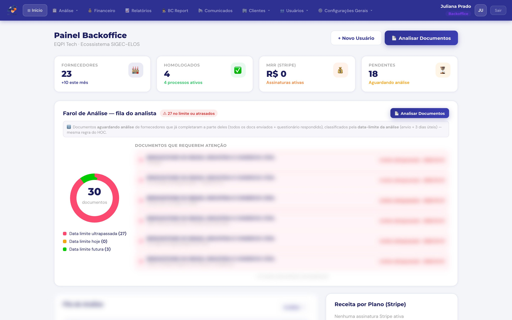

---

## 3. Análise de Documentos (a fila)

Menu **Análise → Análise de Docs**. É a bancada principal: a fila de documentos de **todos** os fornecedores, para trabalhar documento por documento.

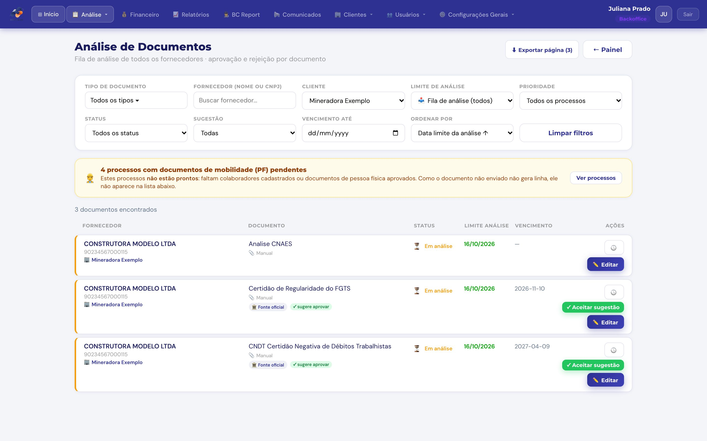

**Filtros** (ficam salvos enquanto a aba estiver aberta):

- **Tipo de documento** e **Fornecedor** (nome ou CNPJ, inclusive CNPJ com letras);
- **Cliente** (ou **ELOS** — processo próprio, sem cliente);
- **Limite de análise:** fila completa, data limite ultrapassada, hoje, futura — ou "fora da fila também";
- **Prioridade:** só os que o cliente pediu para priorizar (**⚡ Prioritária**);
- **Status** do documento;
- **Sugestão** da automação: fonte oficial (Rota A), IA (Rota B), sugere aprovar, sugere reprovar, revisar, sem sugestão;
- **Vencimento até** e **ordenação**.

**Exportar página** / **Exportar tudo** geram planilha com a data limite de cada análise.

**Mobilização na lista:** documentos de pessoa física e de posto aparecem com a marca **👷 Mobilização**. O fornecedor que ainda tem colaboradores ou documentos de PF faltando ganha a etiqueta **👷 PF pendente**, e o aviso no alto da tela (**Ver processos**) lista os processos que não estão prontos por causa da Mobilização.

### Analisar um documento

Na linha do documento:

- **👁** abre o arquivo; **🕓** mostra o histórico, com as **versões** de cada envio e **Ver arquivo** de cada uma.
- **✓/✕ Aceitar sugestão** abre a decisão já preenchida com a sugestão da automação.
- **✏️ Editar** abre a janela completa:

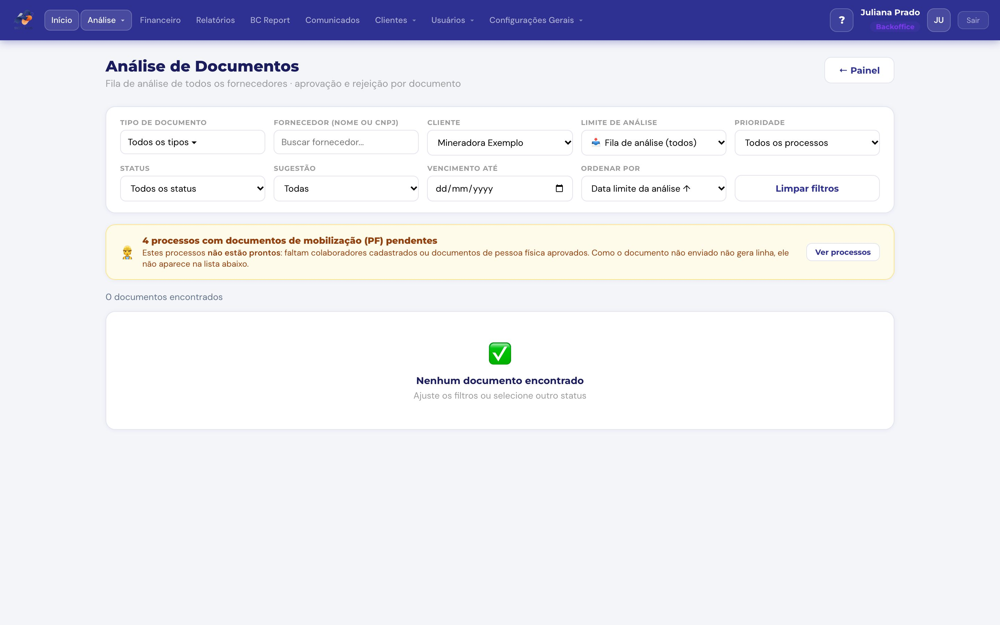

Na janela **Editar Documento**:

- **Sugestão** da fonte oficial ou da IA, com o motivo — aceitar com um clique ou decidir diferente.
- **Como validar este documento** — a regra do catálogo para aquele tipo.
- **Substituir documento** — quando a própria equipe obteve a versão nova; o documento fica aprovado.
- **Data de vencimento** — o botão **análise + 1 ano** preenche o padrão; a validade sugerida pela fonte aparece quando existe.
- **Status:** Aprovado, Reprovado (motivo obrigatório, com busca nos motivos padrão), Não se aplica, ou **Voltar para análise** (reverter uma decisão, com motivo).
- Reprovar documento de um fornecedor **já homologado** pede confirmação, porque **suspende** a homologação vigente.

Ao reprovar, o vencimento é preenchido com a **nova checagem em 4 meses**.

### Validação do CNAE

A **Análise de CNAEs** e o **Simples Nacional** são exigidos em **todo processo**, de qualquer cliente. Aprovar a Análise de CNAEs abre antes a janela **🧩 Validação do CNAE**, que vincula cada categoria do processo a um CNAE do fornecedor (principal ★ ou secundário):

- O contador mostra **x de y categorias vinculadas** e quantas estão sem CNAE; **mostrar só as sem CNAE** filtra as pendentes.
- Depois de escolher um CNAE, **↻ Repetir nas N sem CNAE** aplica o mesmo CNAE às categorias ainda sem vínculo, e **Aplicar em todas** substitui em todas (pede confirmação).
- **Não é preciso vincular todas.** A categoria que ficar sem CNAE é gravada como **reprovada dentro do processo** — o processo segue normalmente. O botão mostra quantas ficarão reprovadas.
- A categoria reprovada aparece **riscada** na ficha (**✕ Reprovada (sem CNAE)**), marcada para o cliente, e sai do certificado, do perfil, das buscas por categoria e das cotações. A carta de exceção não se aplica a ela.

### Dados bancários e DRE

- **Comprovante bancário e DRE/balanço:** o botão **🤖 Analisar** abre a extração por IA (banco, agência, conta; receita, ativo…) para revisar.
- A IA lê o **documento aberto** na janela (sem ele, o comprovante bancário do fornecedor).
- Ao **aprovar** o comprovante bancário, os dados digitados são **salvos antes** da aprovação — a tela confirma que salvou. Na aba **Dados Bancários** da ficha, use **💾 Salvar Dados Bancários**.

---

## 4. Ficha do processo

Abra pelo nome do fornecedor (ou em **Processos**). A ficha reúne:

- Faixas de alerta: **análise prioritária** pedida pelo cliente (com a observação) e **sanções** ativas;
- **Inteligência CNPJ** (Receita + Portal da Transparência), quadro societário e sanções registradas manualmente (**+ Nova Sanção**);
- **Categorias de atuação** (as reprovadas por CNAE aparecem riscadas) e **Análise Assertiva** (relatório de crédito — consulta paga, só para processo liberado);
- Abas **Documentos**, **Questionário**, **Dados Bancários**, **DRE / Financeiro**, **Log do Processo** e **Convites**;
- **Arquivar cadastro** (com motivo) / **Desarquivar**.

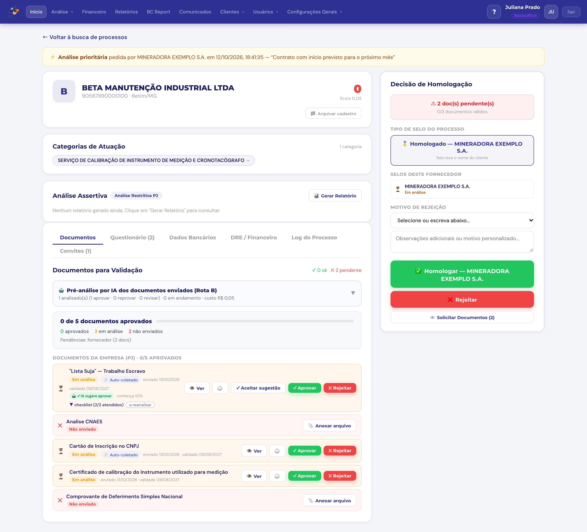

### Aba Documentos

Escolha o **Processo** (cliente) no seletor para ver só o que aquele fluxo exige. A aba mostra o processo do mesmo jeito que o fornecedor e o cliente veem:

- o resumo (**Documentação completa** ou os aprovados, em análise, não enviados, reprovados e vencidos, e as pessoas a cadastrar);
- **Documentos da empresa (PJ)** — os exigidos e, na mesma lista, os documentos enviados **fora da matriz** do processo (que não entram na conta dos exigidos);
- **👷 Mobilização (PF)** — um cartão por posto, com os documentos do posto, os colaboradores e os documentos de cada pessoa.

Ações em cada linha: **Aprovar**, **Rejeitar** / **Revogar**, **Reverter decisão**, **Ver** e histórico **🕓** (com as versões).

**📎 Anexar arquivo:** documento PJ que **falta**, foi **reprovado** ou **venceu** ganha o botão **📎 Anexar arquivo**. A equipe envia o arquivo **no lugar do fornecedor** (por exemplo, a CNDT ou a Inscrição Estadual obtidas pela EQPI) e o documento entra **em análise** como os demais. Limite de **4,5 MB** (PDF, JPG, PNG ou DOCX).

### Log do Processo

O **Log do Processo** registra tudo: análise iniciada, aprovações e reprovações (inclusive automáticas), reversões, substituições, mudanças de vencimento, reaberturas por reenvio, prioridade, lembretes e coleta automática. O **cliente vê o mesmo log** na ficha dele, filtrado: só o processo com ele (registros do HOC desse processo, análises e decisões no ELOS e alterações no cadastro do fornecedor), sem os eventos internos da EQPI.

---

## 5. Automação: coleta nas fontes oficiais e pré-análise por IA

A automação vale **por processo** (veja [Regras que valem para tudo](#1-regras-que-valem-para-tudo)): processos do ELOS, e processos do HOC só depois da migração oficial do cliente, sempre **liberados** (pagos ou subsidiados). **Nada é aprovado sozinho** — a decisão é sempre do analista.

### Coleta nas fontes oficiais (Rota A)

Assim que o processo é liberado, a plataforma busca nas fontes oficiais os documentos públicos que o fluxo exige: Cartão CNPJ, Simples Nacional, Sintegra e **Inscrição Estadual**, CND Federal, FGTS, CNDT, CND estadual e municipal, Dívida Ativa, Lista Suja, falência, IBAMA e alvará da Polícia Federal. O documento entra **Em análise** com o comprovante e uma **sugestão** (aprovar, reprovar ou revisar).

Na ficha, o painel **Coleta automática nas fontes oficiais** mostra, por documento, a fonte consultada, a situação (**Obtido**, **Com o fornecedor**, **Nova tentativa**, **Na fila**, **Consultando**), o resultado, as tentativas e o custo.

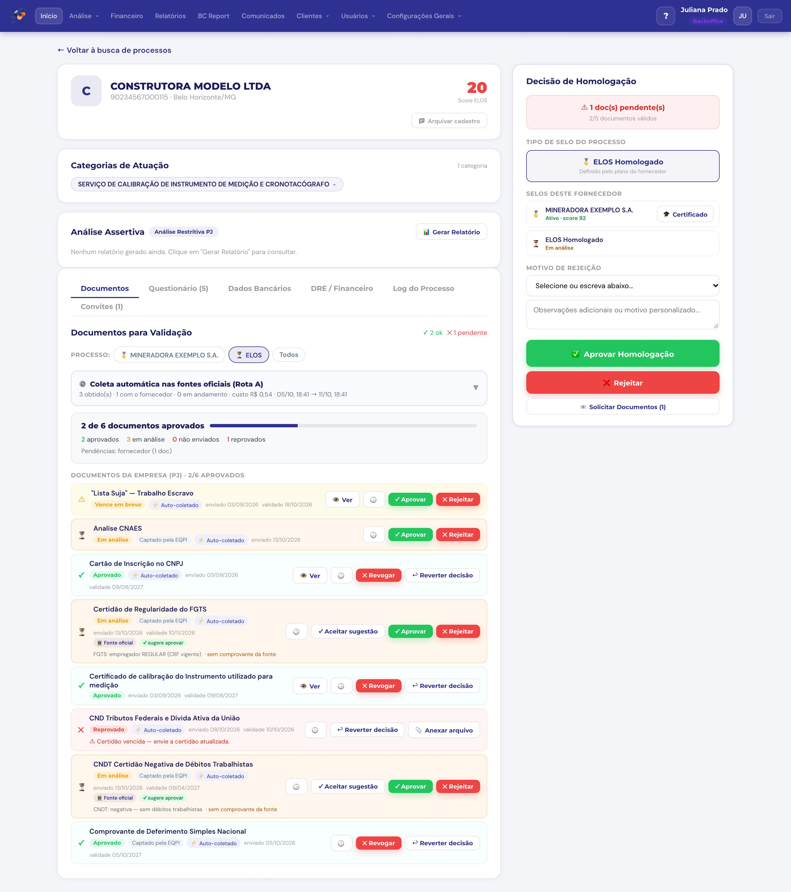

- **Falha passageira da fonte:** a plataforma tenta **3 vezes ao longo do dia** (agora, +1 h, +2 h) antes de liberar o envio manual ao fornecedor.
- **A fonte não emite** (pendência do fornecedor, praça sem serviço): o documento volta para o fornecedor enviar, com a mensagem da fonte.
- **Certidão positiva:** quando a fonte emite certidão **positiva** (com o PDF oficial), ela entra como documento **Em análise**, com o comprovante e a **sugestão de reprovar** — o fornecedor precisa regularizar.
- **Inscrição Estadual:** buscada no Sintegra da UF. Se a fonte falhar, **fica com a EQPI** — nunca é pedida ao fornecedor. Obtenha e use **📎 Anexar arquivo** na ficha.
- **Dívida ativa federal:** vem da **CND federal oficial** (Receita/PGFN), com PDF.

**Renovação automática:** documento que a Rota A sabe buscar é consultado de novo quando vence em até 7 dias ou **já venceu (até 90 dias)** — inclusive o que o fornecedor enviou à mão — e volta para a fila com a nova sugestão.

### Pré-análise por IA (Rota B)

Para documentos **enviados pelo fornecedor no ELOS** (arquivos do HOC ficam de fora), a IA lê o arquivo e sugere aprovar, reprovar ou revisar, com a confiança e o checklist conferido (titularidade, validade, regra do documento). O painel **Pré-análise por IA** mostra as análises, a concordância do analista e o custo. Há um **teto diário de gasto**. Em cada documento, **Pré-analisar com IA** ou **↻ reanalisar** pede uma nova leitura.

---

## 6. Decisão de homologação

No painel **Decisão de Homologação** da ficha:

- **Documentação completa** ou a contagem de pendentes (inclusive Mobilização);
- o selo que será emitido (ELOS Verificado ou Homologado — nome do cliente);
- **Cartas de exceção** enviadas pelo cliente, com **🏅 Homologar com Exceção**;
- **Aprovar Homologação**, **Rejeitar** ou **Solicitar Documentos**.

O botão de aprovação fica bloqueado e explica o motivo: **💳 Aguardando pagamento**, **🚫 N doc(s) impeditivo(s)** ou **🚫 Mobilização (PF) incompleta** (faltam pessoas ou documentos de PF).

**📧 Solicitar Documentos** manda um e-mail ao fornecedor com o que falta: documentos PJ (sem os de responsabilidade do cliente e sem os obtidos pela EQPI), questionário pendente e a Mobilização agrupada **por posto e por pessoa** (colaboradores a cadastrar e documentos a enviar).

**Finalização automática:** quando o **último documento** do processo é analisado, o processo fecha sozinho:

- tudo aprovado → selo **Ativo** e e-mail de homologação com o certificado;
- algum reprovado → processo **Reprovado** e e-mail com as pendências. Quando o fornecedor reenvia, o processo reabre.

Selo já emitido: **↩ Reverter Análise** devolve o processo para a fila e revoga o selo.

---

## 7. Processos

Menu **Análise → Processos**: busca geral de fornecedores por CNPJ ou razão social, com filtro de **cliente** (ou ELOS) e de **situação**: Prioritários, Homologado, Em análise, Aguardando pagamento, Suspenso, Reprovado, Cadastro (sem processo) e Convidado (sem cadastro). **Mostrar inativos e arquivados** inclui os arquivados.

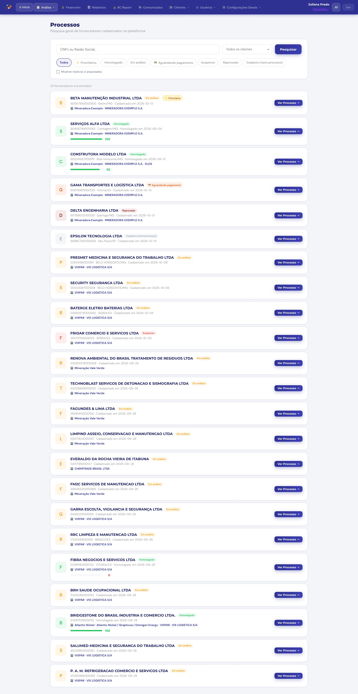

---

## 8. Homologados

Menu **Análise → Homologados**: fornecedores com selo, com contadores de ativos, suspensos e reprovados. **Ver Ficha**, **Inativar** (o selo é suspenso e o fornecedor sai do marketplace; motivo obrigatório) e **Reativar**.

A homologação do HOC com **validade vencida** (renovação não paga) é reavaliada todo dia e **deixa de aparecer como homologada**.

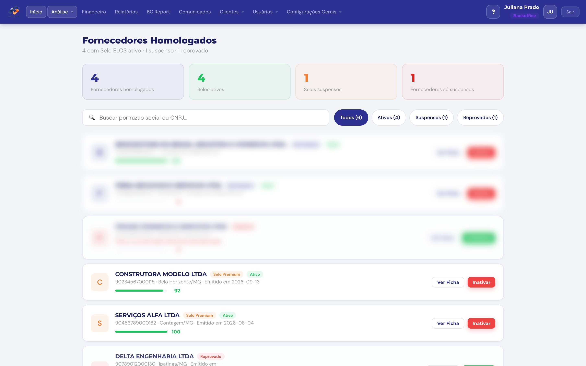

---

## 9. Convites

Menu **Análise → Convites**: todos os convites da plataforma, com filtros de status, origem (ELOS ou histórico do HOC) e cliente. **Detalhes** mostra quem enviou, quando foi visualizado, os lembretes e a mensagem. **Copiar link**, **Reenviar**, **Cancelar** e **Ver processo**.

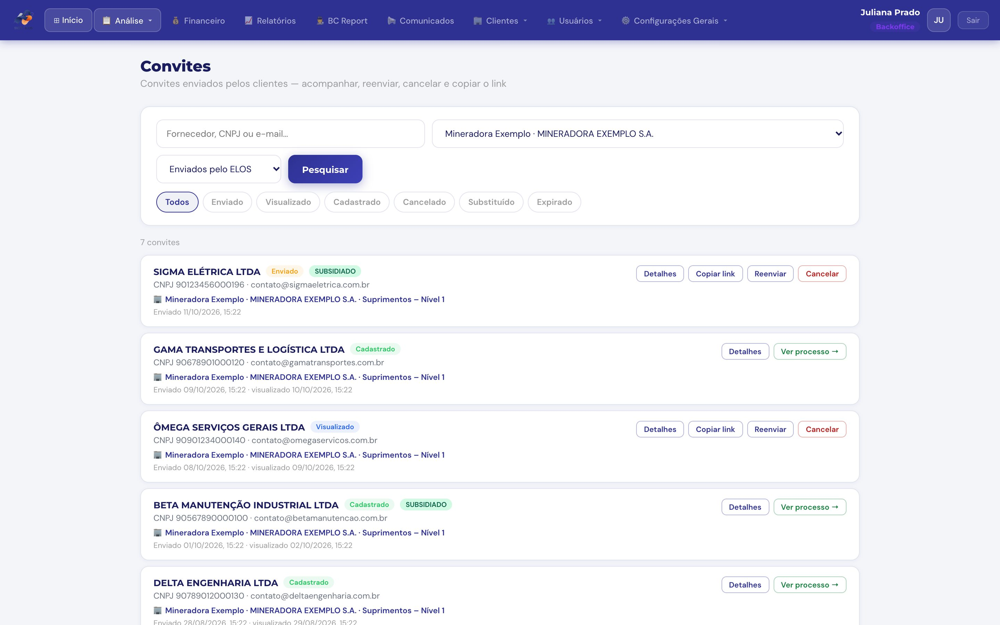

**💰 Tornar subsidiado (a pedido do cliente).** Passa um convite "fornecedor paga" para subsidiado, com a mesma regra da tela do cliente: vale na hora se o fornecedor não pagou; com **boleto do ELOS emitido**, fica **agendada** até o vencimento (boleto emitido não pode ser cancelado na Stripe); se já pagou, se o boleto é do HOC ou se o convite é do HOC, não é possível. Fica registrado que a troca foi feita pela EQPI. Se, mesmo assim, cair um pagamento do fornecedor num processo já subsidiado, a nota fiscal fica **retida para revisão** e o suporte recebe um aviso — boleto não tem estorno; decidir com o cliente (crédito ou devolução).

---

## 10. Questionários

Menu **Análise → Questionários**: crie e mantenha os questionários dos clientes. **+ Novo Questionário** (cliente, título, descrição), depois **+ Adicionar Pergunta** com o tipo (Sim/Não, texto, opções) e se é obrigatória.

**Alerta de compliance:** em cada pergunta, defina a resposta que acende um alerta (por exemplo, "dispara quando responder SIM"). Os alertas aparecem para o cliente no menu Compliance.

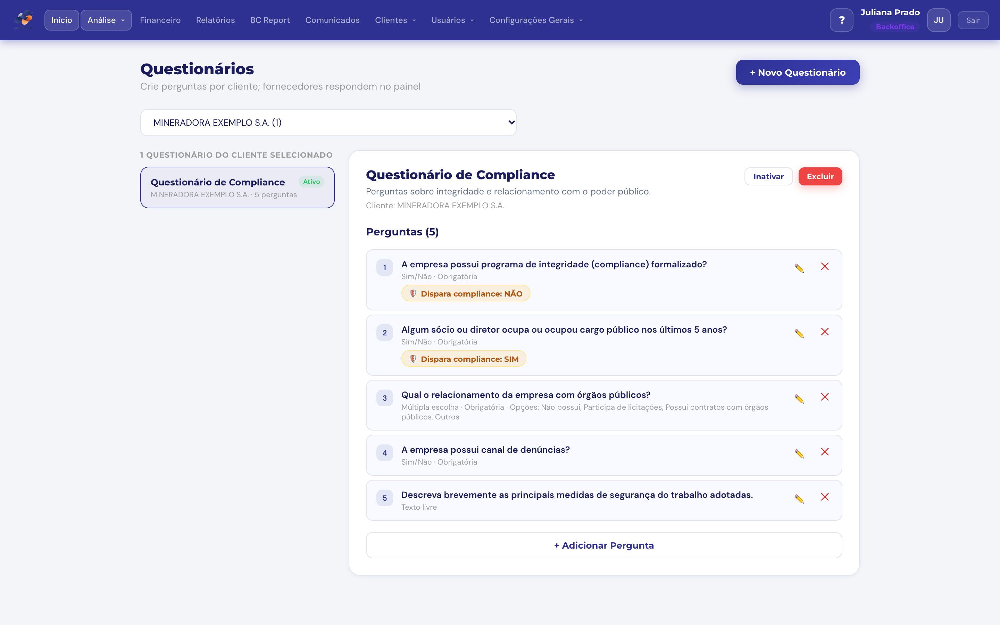

---

## 11. Financeiro

Menu **Financeiro**:

- **Visão Geral** — assinaturas, receita recorrente, **Subsidiados cobráveis** (com quantos estão **em aberto**, ou seja, o cliente ainda não pagou), selos por status;
- **Assinaturas** — pagamentos do Stripe, renovações, repasse previsto e nota fiscal;
- **Subsidiados** — homologações pagas pelos clientes, para faturar;
- **Custos BC**, **Custos Captura** (coleta nas fontes oficiais: custo do mês, por fonte e por cliente) e **Custos IA** (pré-análise: custo do mês, gasto do dia, concordância do analista) — visíveis para quem tem a permissão de custos.

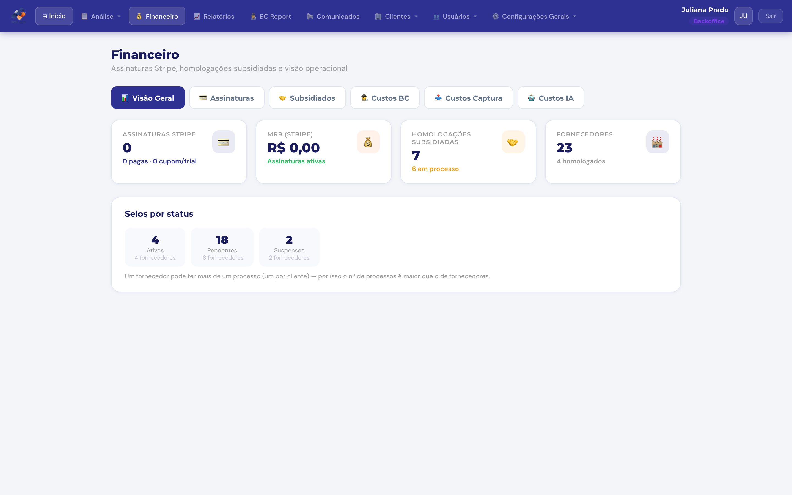

### Assinaturas

A lista mostra fornecedor, plano, status, **Pagamento**, valor, data do pagamento, **Repasse (prev.)** — com o **meio de pagamento** (Cartão, Pix ou Boleto) logo abaixo da data —, vigência e NFSe. A planilha exportada traz também as colunas **Meio** e **Repasse Stripe (prev.)**.

O repasse é a data em que o Stripe libera o valor. Vale a data informada pelo próprio Stripe; sem ela, a data aparece com asterisco (estimativa pelo meio de pagamento): **cartão nacional 30 dias corridos**, **cartão internacional 5 dias**, **Pix e boleto 2 dias úteis**. O repasse do Stripe para a conta é diário.

### Subsidiados

**Regra de cobrança:** o processo subsidiado é **cobrável do cliente quando entra na esteira** — envio de documentos completo (inclusive Mobilização) e questionário respondido —, **seja qual for o resultado** da homologação.

- Entram os clientes do ELOS e os clientes migrados do HOC (só o que entrou na esteira **depois** da migração).
- Ficam de fora os clientes inativados e os clientes ainda operados no HOC.
- **Valor** = preço subsidiado do fluxo do processo.

Filtros: cliente, **Em aberto** / **Pagos pelo cliente** / **Todos** e período (pela data de entrada na esteira). Para registrar que o cliente pagou, marque os processos e clique em **💰 Dar baixa (cliente pagou)**, informando a **data do pagamento** e a **referência** (nota fiscal, boleto, fatura). **Desfazer baixa** reverte (fica no histórico).

**⬇️ Excel p/ financeiro** exporta com as colunas: Cliente, Fornecedor, CNPJ, Fluxo, Entrou na esteira, Resultado, Valor, Pago pelo cliente em e Referência do pagamento.

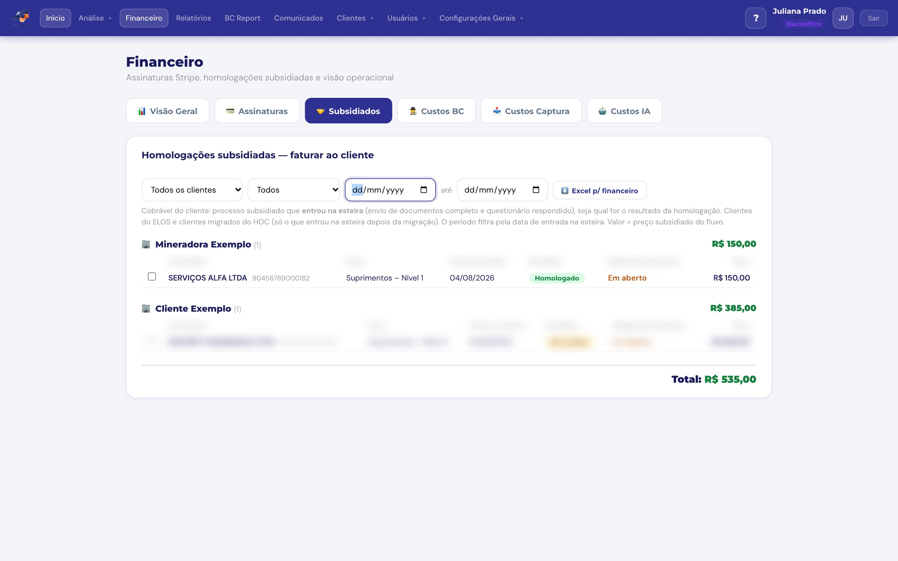

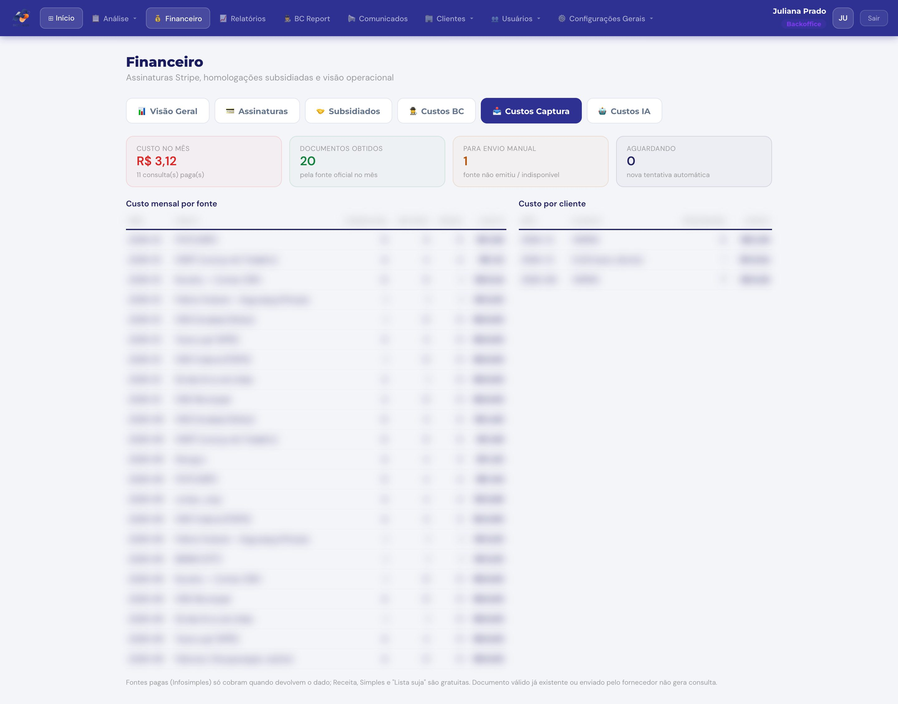

---

## 12. Relatórios, BC Report e Comunicados

- **Relatórios** — painel executivo e funil da campanha de primeiro acesso dos migrados.
- **BC Report** — emissão do relatório de background check (Light ou Full) por CNPJ; consome créditos e exige permissão.
- **Comunicados** — banners exibidos na tela de login (novidades, manutenção, feriados), com período de exibição.

---

## 13. Clientes: cadastro, fluxos, portais e termos

**Lista de Clientes** — todos os clientes, com o preço da homologação e quem paga (subsidiado ou fornecedor). **Editar** e **Convidar fornecedor**. Cliente inativo aparece com a etiqueta **INATIVO (HOC)**: ele não envia convites e o portal dele não aceita novos cadastros (mostra só **Acessar Plataforma**).

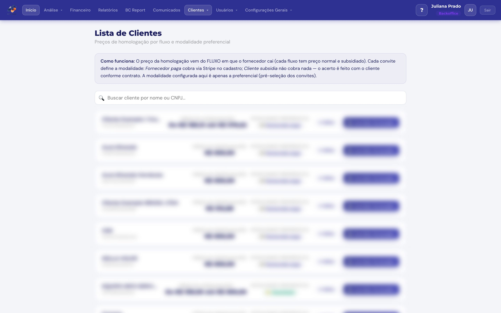

**Novo Cliente** — assistente em 4 etapas: empresa (com consulta do CNPJ), precificação, portal de fornecedores e revisão. No fim, mostra o acesso do usuário master.

**Fluxo de Homologação** — por cliente:

- **Fluxos de categorias:** os pacotes (níveis) de homologação, cada um com o preço **não subsidiado** e **subsidiado** e as categorias que inclui; um fluxo é o **padrão**;
- **Matriz de documentos:** os documentos exigidos por categoria, e quais são **desclassificatórios** (suspendem o selo se vencidos);
- **Mobilização:** postos de trabalho e documentos por pessoa e por posto.

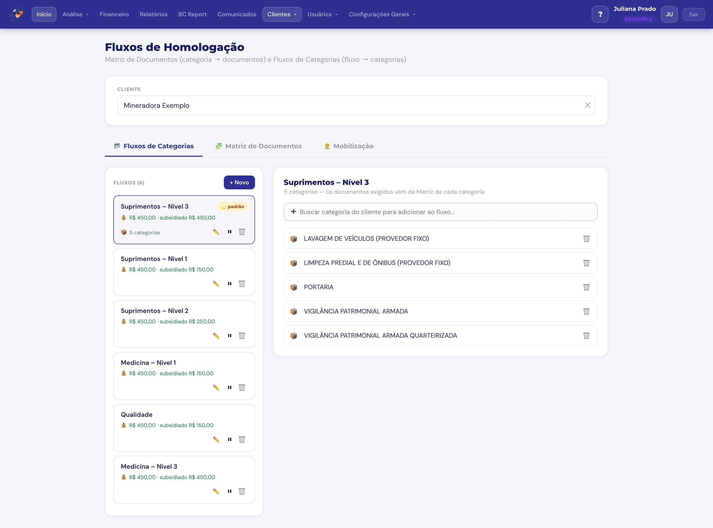

> **Clientes do HOC:** para clientes ainda operados no HOC, matrizes e categorias vêm do HOC — altere lá. Para **clientes migrados**, o ELOS é o dono: altere aqui.

**Portais White-label** — a página de cadastro com a marca do cliente (mesmo editor que o cliente usa).

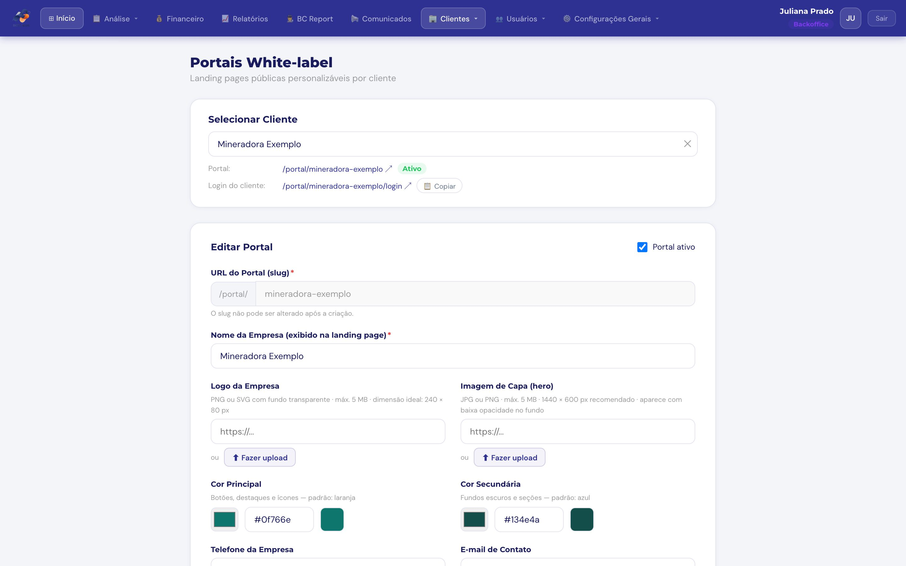

**Termos de Aceite** — os documentos que o fornecedor aceita no cadastro, por cliente.

---

## 14. Usuários e perfis de acesso

**Lista de Usuários** — busca por nome, e-mail ou CNPJ e filtros por papel. Cada usuário mostra **todas as empresas** a que tem acesso (fornecedor ou cliente), com **👑** na empresa em que ele é o master. Ações:

- **tornar master** (ao lado da empresa) — torna o usuário o master daquela empresa; o master atual continua na equipe, sem ser master. Fica registrado no histórico;
- **Editar**, **Reset Senha**, **Bloquear** / **Desbloquear**;
- **🔐 Reset MFA** — para quem perdeu o celular da verificação em duas etapas. O usuário cadastra o autenticador de novo no próximo acesso, e **todos os navegadores lembrados** dele deixam de valer.

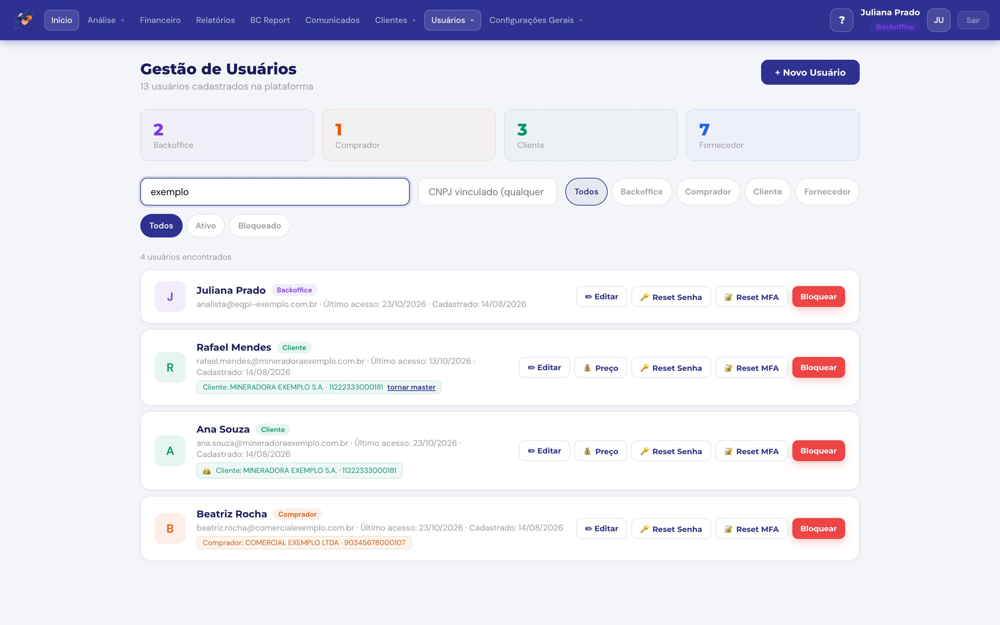

**Novo Usuário** — crie comprador, cliente, fornecedor ou backoffice, escolhendo o **perfil de acesso**. A senha gerada é mostrada uma vez e enviada por e-mail.

**Perfis de Usuário** — defina, para clientes, fornecedores, compradores e backoffice, quais **módulos** (menus) e **ações** cada perfil libera. Usuário sem perfil, ou com perfil sem ações marcadas, tem acesso total.

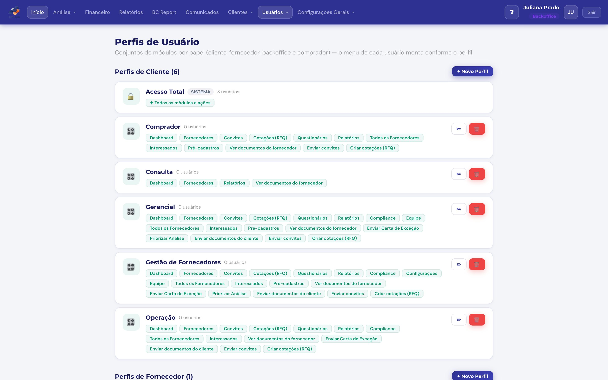

---

## 15. Configurações gerais

- **Preços ELOS** — os valores dos planos ELOS Verificado e ELOS Homologado (precisam coincidir com os preços cadastrados no Stripe).
- **Feriados** — datas que ajustam os prazos de análise.
- **Catálogo de Docs** — os tipos de documento, a responsabilidade (fornecedor ou cliente), o prazo de análise e a **regra de validação** que aparece para o analista.

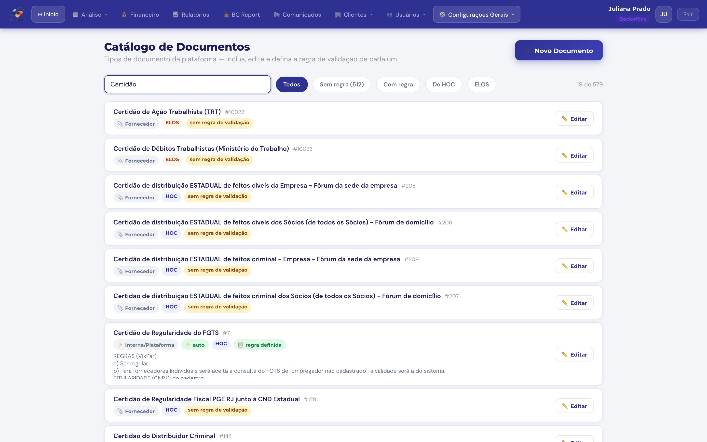

---

## 16. Dúvidas frequentes

**Corrigi um dado de um fornecedor do HOC e voltou ao valor antigo.**
Isso só acontece com clientes **ainda operados no HOC**: os registros vindos de lá são sobrescritos pela sincronização da madrugada. Corrija no HOC. Para clientes migrados, o ELOS é o dono e a alteração permanece.

**Um processo não aparece na fila.**
Só entram na fila os processos em que o fornecedor completou a parte dele (documentos, questionário, Mobilização e pagamento). Documento reprovado ou vencido não conta como enviado. Use o limite de análise **— Fora da fila também —** para ver todos.

**Aprovei o último documento e o processo não foi homologado.**
Verifique se há documento reprovado ou de Mobilização pendente — o aviso depois de salvar diz o que falta, e o botão de aprovação mostra o bloqueio (**🚫 Mobilização (PF) incompleta**, doc impeditivo). Processo sem pagamento confirmado também não pode ser homologado.

**Fornecedor quer trocar um documento.**
Antes de o processo entrar na fila, ele mesmo troca com **↻ Substituir** (vira uma nova versão, e a anterior fica no histórico). Com o processo já na fila, ele só reenvia o documento reprovado ou renova o que vence. Se a troca for necessária nessa fase, a equipe pode reprovar o documento (com o motivo) para liberar o reenvio, ou usar **Substituir documento** na janela Editar quando a própria equipe tem a versão correta.

**A Inscrição Estadual não foi obtida automaticamente.**
Ela nunca é pedida ao fornecedor: obtenha no Sintegra e use **📎 Anexar arquivo** na ficha.

**Um fornecedor perdeu o celular da verificação em duas etapas.**
Em **Usuários**, use **Reset MFA** (os navegadores lembrados também são revogados).

**A sugestão da automação está errada.**
Decida diferente: a sugestão nunca aprova sozinha. Discordâncias ficam registradas e aparecem em Custos IA (concordância do analista).

---

**Ajuda:** o botão **?** no alto da tela abre a página **Ajuda**, com os quatro manuais em PDF e os canais de suporte que são divulgados aos usuários: e-mail **suporte@eqpitech.com.br**, WhatsApp **(11) 5039-6769** e telefone **(11) 2305-3881**.
