# Manual do Cliente — SIGEC-ELOS

**Para quem é este manual:** empresas contratantes que homologam seus fornecedores pelo SIGEC-ELOS — equipes de suprimentos, compras e compliance.

**O que o SIGEC-ELOS faz por você:** você convida seus fornecedores, eles se cadastram e enviam a documentação pela internet, a equipe da EQPI analisa, e você acompanha cada processo até a homologação — com certificados que podem ser conferidos publicamente.

> As telas deste manual mostram empresas e pessoas **fictícias** (Mineradora Exemplo, Construtora Modelo, etc.).

---

## Sumário

1. [Acesso](#1-acesso)
2. [Painel](#2-painel)
3. [Relatórios](#3-relatórios)
4. [Meus Fornecedores](#4-meus-fornecedores)
5. [O processo de um fornecedor](#5-o-processo-de-um-fornecedor)
6. [Priorizar análise](#6-priorizar-análise)
7. [Carta de exceção](#7-carta-de-exceção)
8. [Inativar e reativar um fornecedor](#8-inativar-e-reativar-um-fornecedor)
9. [Todos os Fornecedores (busca)](#9-todos-os-fornecedores-busca)
10. [Interessados](#10-interessados)
11. [Pré-cadastros](#11-pré-cadastros)
12. [Questionários](#12-questionários)
13. [Compliance](#13-compliance)
14. [Convites](#14-convites)
15. [Cotações (RFQ)](#15-cotações-rfq)
16. [Equipe e perfis de acesso](#16-equipe-e-perfis-de-acesso)
17. [Portal de Fornecedores](#17-portal-de-fornecedores)
18. [Termos e Aceites](#18-termos-e-aceites)
19. [Dúvidas frequentes](#19-dúvidas-frequentes)

---

## 1. Acesso

- Entre em `elos.eqpitech.com.br` → **Entrar**, ou pelo link de login com a marca da sua empresa (veja [Portal de Fornecedores](#17-portal-de-fornecedores)).
- **Esqueci minha senha:** use o link na tela de login.
- **Verificação em duas etapas:** a plataforma pede que você ative um código no celular (Google Authenticator, Microsoft Authenticator…). Você tem **30 dias** para ativar. Depois de digitar um código válido, **este navegador fica lembrado por 24 horas**: um novo login nesse prazo não pede o código. Trocou de celular? Use **Minha Conta → Trocar de aparelho**. Perdeu o acesso ao aplicativo? Fale com o suporte para resetar a verificação.
- **Ajuda:** o botão **?** no alto da tela abre a página **Ajuda**, com os manuais em PDF e os canais de suporte da EQPI.
- O menu mostra só os módulos liberados pelo seu **perfil de acesso** (veja [Equipe e perfis de acesso](#16-equipe-e-perfis-de-acesso)).

---

## 2. Painel

A tela inicial resume seus fornecedores:

- **Fornecedores** — total com processo de homologação com você.
- **Homologados** — com homologação vigente.
- **Em análise** — inclui os que ainda aguardam pagamento.
- **Subsidiados** — homologações pagas pela sua empresa.
- **Carta de Exceção** — homologados com exceção aprovada por você.
- **Fornecedores Recentes** e atalhos para convidar.

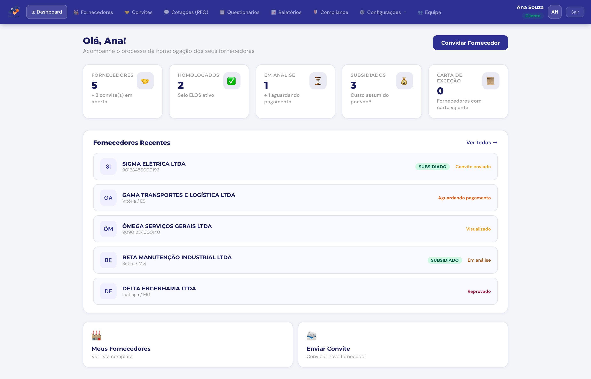

---

## 3. Relatórios

Menu **Relatórios**: indicadores (fornecedores, homologados vigentes, em homologação, processos a vencer e vencidos, documentos a vencer) e gráficos de situação dos processos, funil de convites, homologações por mês, cotações e respostas de questionário.

Use **Data início** e **Data fim** e clique em **Aplicar** para ver um período (**Limpar** volta a todo o período):

- **Seguem o período:** fornecedores e processos iniciados, convites, cotações e homologações por mês.
- **Mostram sempre a situação atual:** documentos a vencer/vencidos e as respostas dos questionários dos homologados.

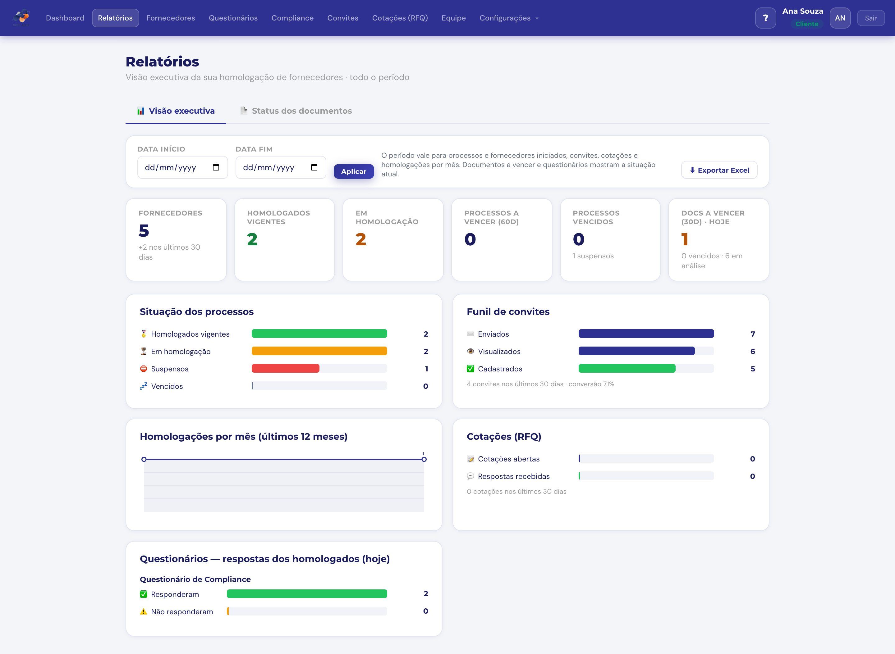

---

## 4. Meus Fornecedores

Menu **Fornecedores → Meus Fornecedores**. Use a busca (nome ou CNPJ) e os filtros:

- **Situação** — Homologado, Em análise, Aguardando pagamento, Reprovado, Suspenso / inativado, Vencido.
- **Nível** — o fluxo (pacote) de homologação.
- **Custeio** — Subsidiado (sua empresa paga) ou Pago pelo fornecedor.
- **Destaques** — **⚡ Prioritários**, Com carta de exceção, Vence em até 60 dias.

**⬇ Exportar Excel (n)** gera a planilha da lista **com os filtros aplicados** (n = quantidade de fornecedores exportados).

As abas **Todos os Fornecedores**, **Interessados** e **Pré-cadastros** aparecem conforme o seu perfil de acesso.

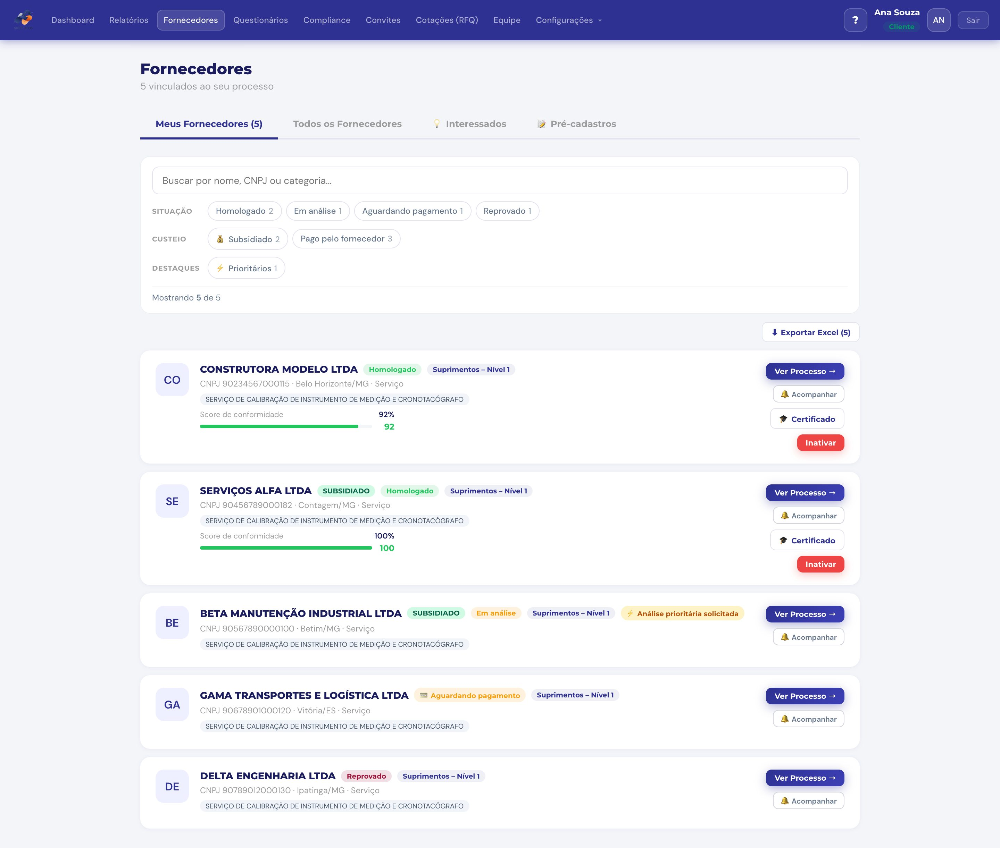

### O que cada situação significa

| Situação | Significado |
|---|---|
| **Homologado** | Fornecedor aprovado, homologação vigente. |
| **Em análise** | Documentação enviada ou em envio; a EQPI está analisando. |
| **Aguardando pagamento** | O fornecedor se cadastrou mas ainda não pagou a homologação (quando é ele quem paga). |
| **Reprovado** | A análise encontrou pendências; o fornecedor precisa corrigir e reenviar. |
| **Suspenso / inativado** | Documento importante vencido, carta de exceção vencida, ou inativado pela sua empresa. |
| **Vencido** | A validade da homologação terminou. |

> **Histórico do HOC:** clientes que vieram do sistema anterior da EQPI (SIGEC-HOC) veem também os processos e convites que vieram de lá, marcados como **HOC**. Eles continuam sendo acompanhados normalmente.

---

## 5. O processo de um fornecedor

Clique em **Ver Processo** para abrir a ficha do fornecedor:

- **Resumo** — progresso dos documentos, dados do convite (tipo de fornecimento, custeio, datas), dados cadastrais e endereço.
- **Documentos** — os documentos do processo **com a sua empresa** (só o que o seu fluxo exige), com situação e validade. Com permissão, **👁 Ver** abre o arquivo e **🕓** mostra o histórico, com as **versões** de cada envio e **Ver arquivo** de cada uma. Documentos buscados automaticamente pela plataforma aparecem como **Auto-coletado**.
- **Questionários** — as respostas do fornecedor.
- **Inteligência CNPJ** — sanções (CEIS/CNEP), regime tributário, atividades (CNAE) e quadro societário.
- **Log do Processo** — o histórico do processo (veja abaixo).

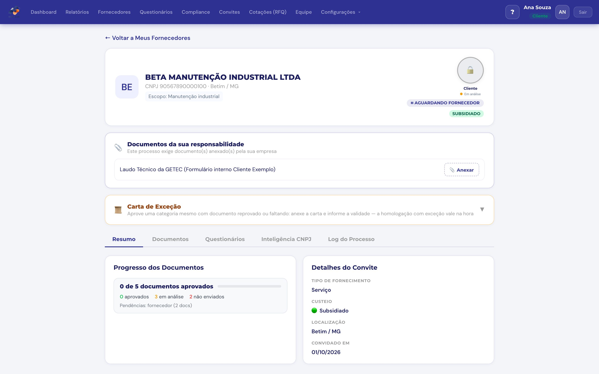

**Documentos de Mobilização:** quando o fornecedor tem mão de obra alocada em postos da sua empresa, a aba **Documentos** mostra também o bloco **👷 Mobilização (PF)**: um cartão por posto, com os documentos do posto, os colaboradores cadastrados e os documentos de cada pessoa. **Nome e CPF dos colaboradores aparecem mascarados.**

**Documentos da sua responsabilidade:** alguns documentos são fornecidos pela sua empresa (por exemplo, um laudo interno). Eles aparecem no bloco **Documentos da sua responsabilidade** — use **📎 Anexar**.

**Categoria reprovada por CNAE:** na análise, a EQPI confere se as atividades (CNAE) do fornecedor cobrem cada categoria. A categoria que a atividade não cobre aparece como **"✕ Reprovada — a atividade (CNAE) do fornecedor não cobre a categoria"**. Para ela a carta de exceção não se aplica, e ela não aparece no certificado nem nas buscas e cotações por categoria.

### Log do Processo

A aba **Log do Processo** mostra o histórico do processo **com a sua empresa** (os últimos 300 eventos):

- registros do SIGEC-HOC desse processo;
- análises e decisões no SIGEC-ELOS (análise iniciada, aprovações, reprovações, reaberturas, prioridade, lembretes, coleta automática);
- alterações no cadastro do fornecedor (dados, sócios, documentos).

Filtre por **Data início**, **Data fim** e **Descrição** e clique em **🔍 Pesquisar**. Eventos internos da EQPI e processos do fornecedor com outros clientes não aparecem.

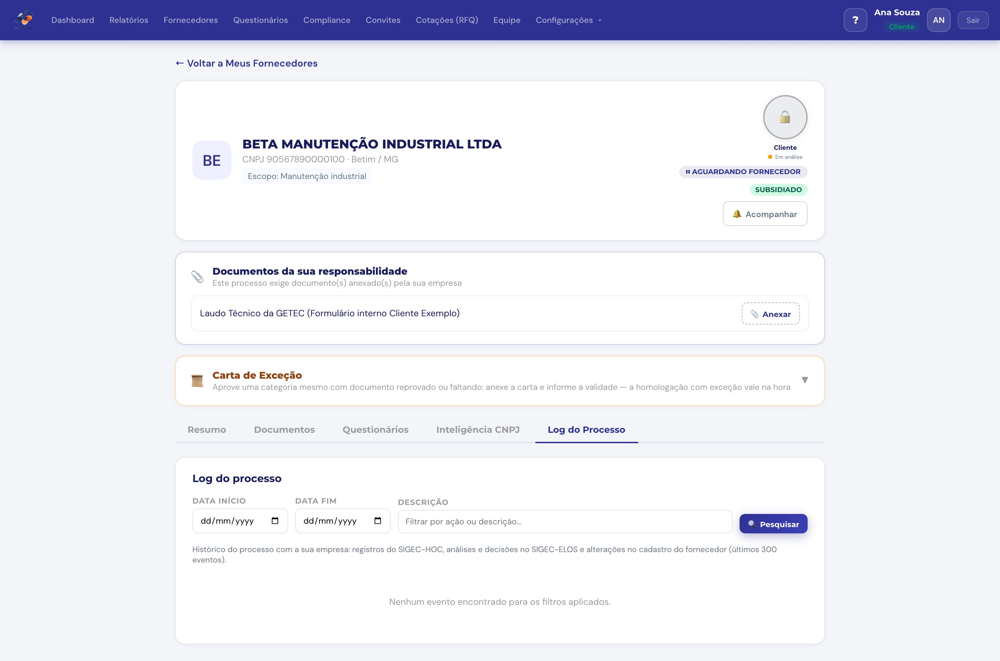

---

## 6. Priorizar análise

Para um fornecedor **Em análise** com urgência, clique em **⚡ Priorizar** em Meus Fornecedores. Informe o motivo (opcional) e clique em **⚡ Confirmar prioridade**. A equipe EQPI passa a analisar esse processo à frente da fila.

- O botão só aparece para processos **realmente em análise** (pagos, subsidiados ou vindos do HOC) e para quem tem essa permissão no perfil de acesso.
- Cada processo pode ser priorizado **uma vez**. Use o filtro **⚡ Prioritários** para acompanhá-los.
- A prioridade **não pula etapas**: o processo só é analisado depois que o fornecedor enviou tudo o que é dele.

Use com moderação, só em caso de urgência real.

---

## 7. Carta de exceção

Quando um fornecedor tem um documento reprovado ou faltando, mas sua empresa decide aceitá-lo mesmo assim (por um período), use a **Carta de Exceção** na ficha do processo:

1. Escolha a categoria.
2. Informe a **validade da carta**.
3. **Anexe a carta** assinada (**📎 Anexar carta**).

A homologação com exceção vale na hora. A plataforma avisa antes do vencimento da carta; com a carta vencida, o processo é suspenso até uma nova carta ou a regularização dos documentos. A carta não vale para categoria reprovada por CNAE.

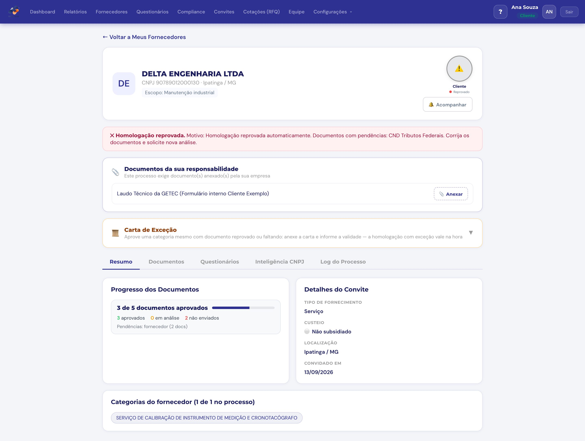

---

## 8. Inativar e reativar um fornecedor

Em Meus Fornecedores, **Inativar** (só para homologados) suspende o processo **apenas no contexto da sua empresa** — o fornecedor não perde a homologação com outros clientes. O motivo é obrigatório. Use **Reativar** para desfazer.

---

## 9. Todos os Fornecedores (busca)

Aba **Todos os Fornecedores**: pesquise toda a base de fornecedores da plataforma com filtros (categoria, estado, cidade, raio a partir de um CEP, porte, capital social, Simples Nacional, selos e certificações). Clique em **Ver Perfil** para abrir a ficha completa. Para você, os contatos aparecem completos.

Para convidar vários de uma vez: marque os fornecedores e clique em **Convidar**.

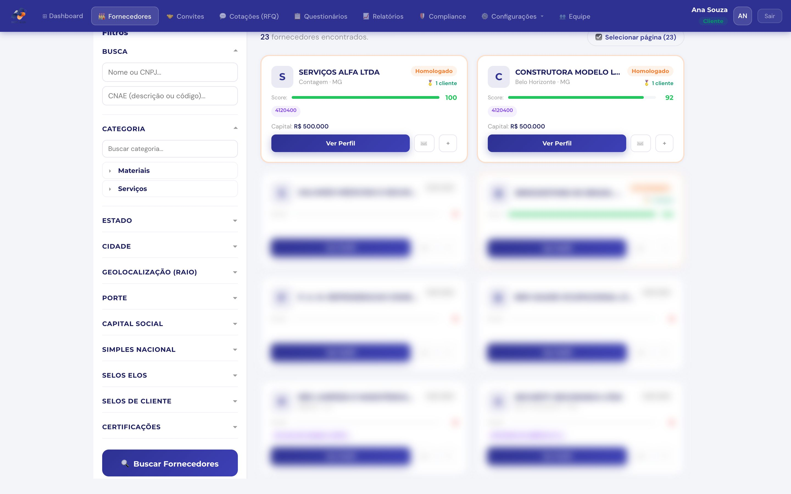

---

## 10. Interessados

Aba **Interessados**: fornecedores homologados na plataforma que declararam interesse em atender sua empresa, com a mensagem de apresentação. Abra a **Ficha**, **Envie um convite** ou remova da lista.

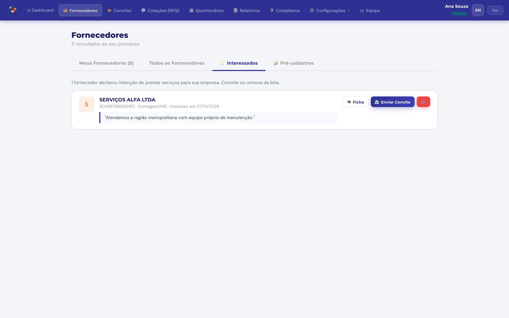

---

## 11. Pré-cadastros

Aba **Pré-cadastros**: empresas que se cadastraram pelo seu portal **sem iniciar a homologação** (opção sem custo). Você vê os dados da empresa e as respostas do questionário (clique em **Questionário: x de y respondidas**), e pode:

- **Enviar Convite** para a homologação;
- **Arquivar** (sai da lista inicial; continua no filtro **Arquivados**) ou **Reativar**.

As etiquetas **CONVIDADO** e **EM HOMOLOGAÇÃO** mostram o andamento.

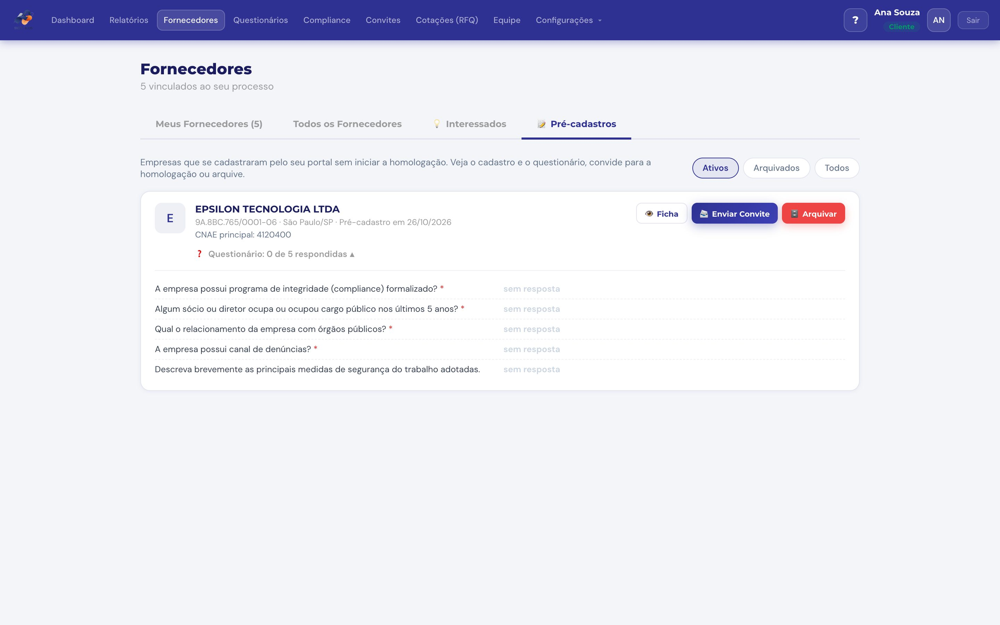

---

## 12. Questionários

Menu **Questionários**: consulte os questionários que seus fornecedores respondem. A criação e as alterações são feitas pela equipe EQPI — peça pelo suporte.

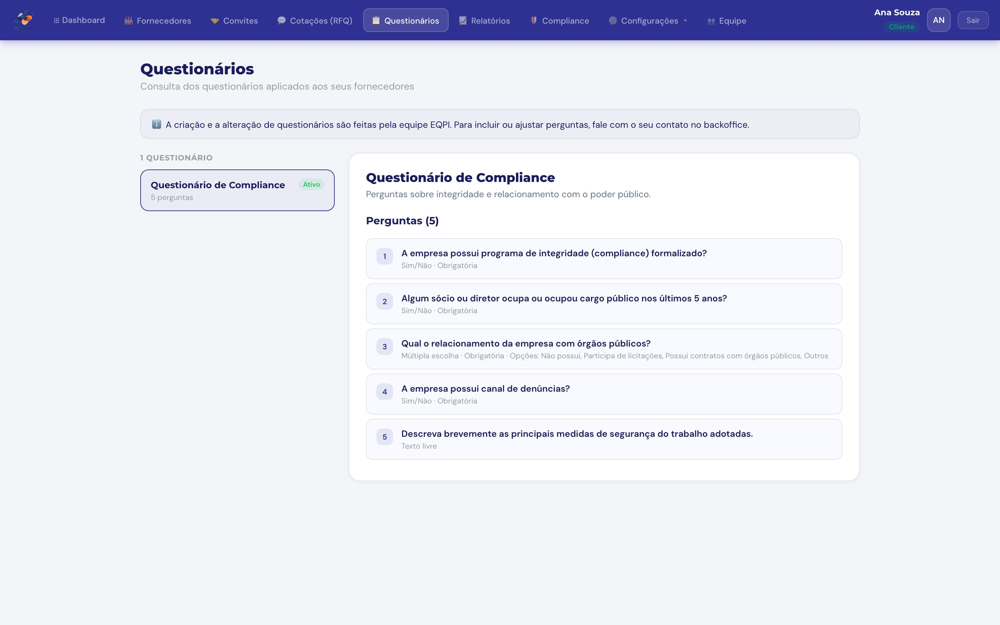

---

## 13. Compliance

Menu **Compliance**: respostas de questionário que acenderam um alerta (por exemplo, "possui sócio com cargo público"). Cada fornecedor em atenção mostra a pergunta, a resposta e a data. **Exportar Excel** gera a planilha. Os alertas não travam a homologação — são informação para sua decisão.

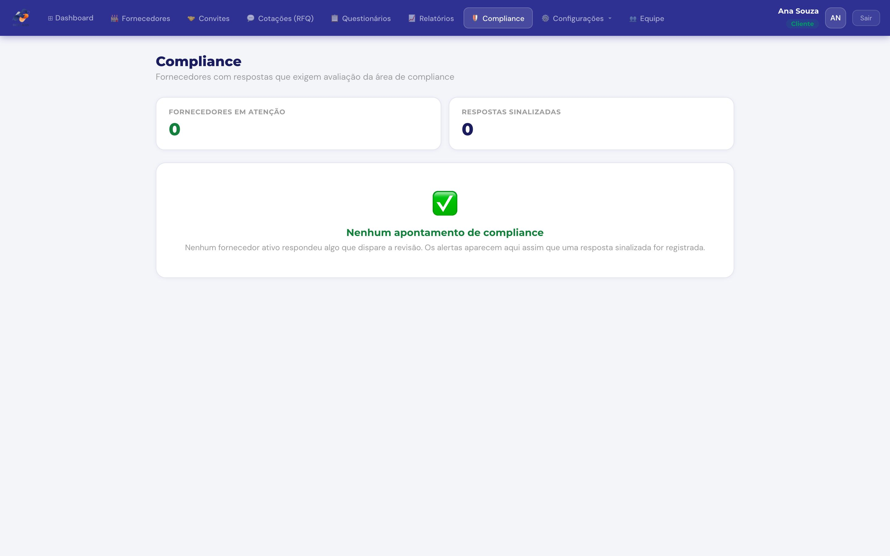

---

## 14. Convites

Menu **Convites**: todos os convites enviados, com busca e filtros (status, nível, custeio, origem, parados há mais de 7 dias, com lembretes). **⬇ Exportar Excel (n)** gera a planilha dos convites **com os filtros aplicados**.

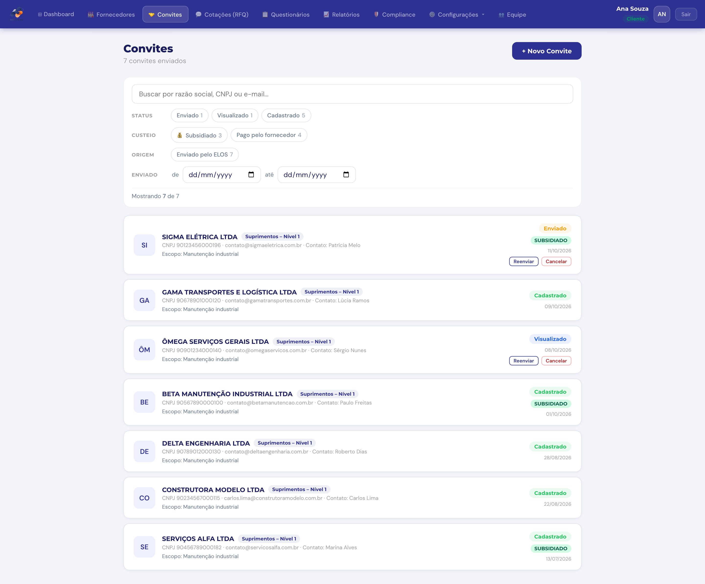

### Enviar um convite

Clique em **+ Novo Convite**:

1. **Objetivo:** **📞 Fazer contato com o fornecedor** (apresentação, sem iniciar homologação) ou **solicitar homologação**.
2. Razão social, CNPJ, e-mail e contato do fornecedor.
3. Para homologação: **tipo de fornecimento**, **Subsidiado?** e **fluxo de homologação** (o pacote de documentos — o padrão já vem marcado).
4. Revise a mensagem e clique em **📨 Enviar Convite** (ou **📞 Enviar Contato**, quando o objetivo é só o contato).

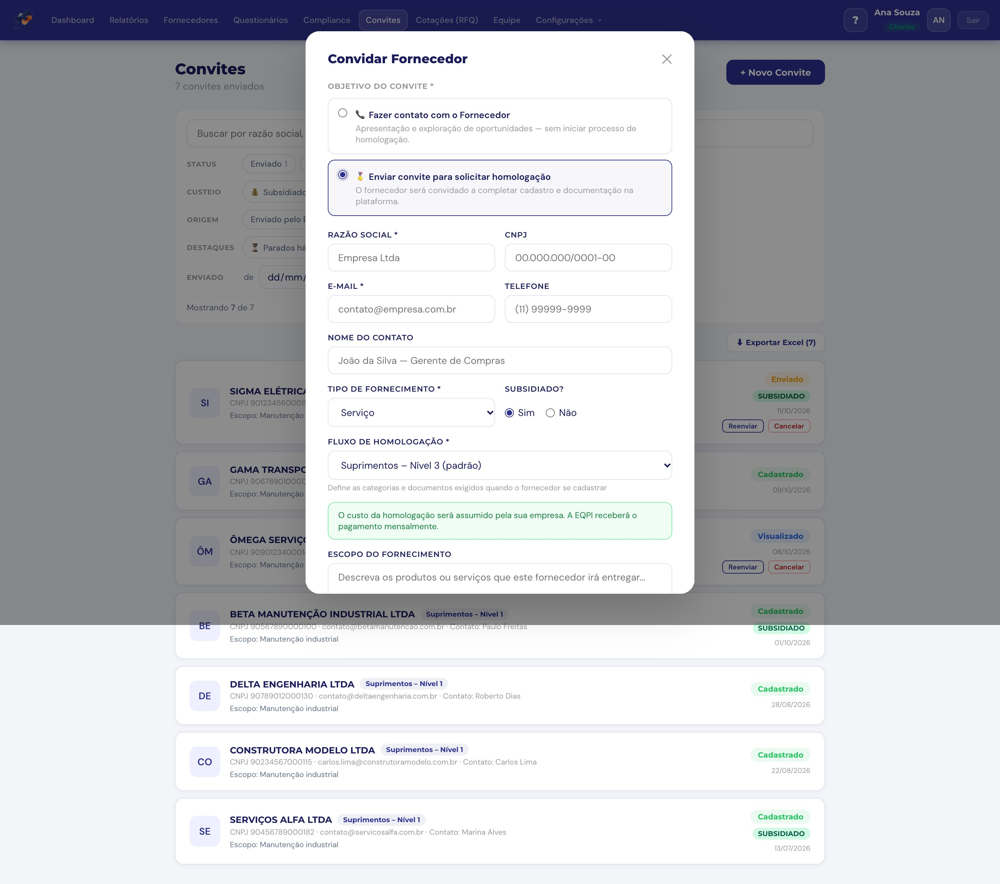

**Subsidiado ou não?**

- **Subsidiado — Sim:** sua empresa paga a homologação. O fornecedor não passa pelo pagamento e entra direto. O processo passa a ser **cobrável da sua empresa quando entra na fila de análise** — ou seja, quando o fornecedor completa o envio dos documentos (inclusive a Mobilização, quando houver) e responde o questionário —, **seja qual for o resultado** da homologação. O valor é o preço subsidiado do fluxo combinado com a EQPI.
- **Subsidiado — Não:** o fornecedor paga o valor combinado com sua empresa. O processo só começa depois do pagamento confirmado.

**Depois do envio:**

- O fornecedor recebe **lembretes automáticos a cada 3 dias, por até 15 dias**, até se cadastrar.
- **Reenviar** manda o convite de novo; **Cancelar** (com motivo) desativa o link.
- Convites marcados **HOC** são histórico do sistema anterior e não recebem lembretes pelo ELOS.

> **Cliente inativo:** enquanto a sua empresa estiver inativa na plataforma, não é possível enviar convites, e o seu portal não recebe novos cadastros.

---

## 15. Cotações (RFQ)

Menu **Cotações (RFQ)** → **+ Nova Cotação**: escreva o título, escolha a **categoria** e o alcance (**sua base homologada** ou **sua base + homologados ELOS**), descreva o pedido e o prazo. A cotação vai para todos os fornecedores homologados da categoria, que também recebem o pedido por e-mail.

Em **Ver respostas** você acompanha quem respondeu e pode **Aceitar** ou **Recusar** cada proposta.

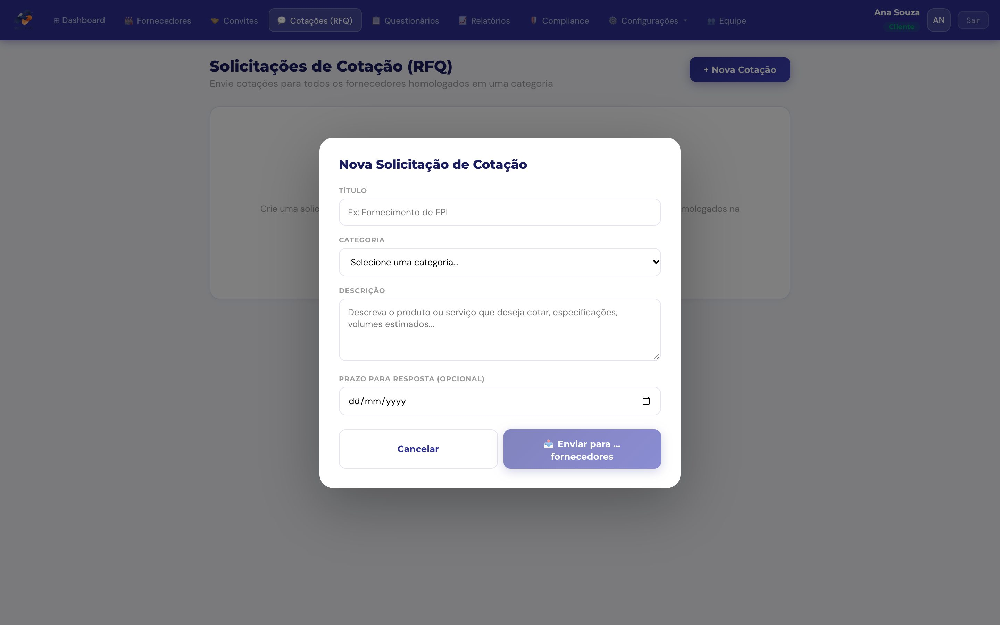

---

## 16. Equipe e perfis de acesso

Menu **Equipe**: os usuários da sua empresa (sem limite). **+ Convidar Usuário** envia o acesso por e-mail. Para cada membro, escolha o **perfil de acesso** (o que ele pode ver e fazer) e use **Desativar** / **Reativar**.

- Cada empresa tem **um único usuário master** (com acesso total). Ele não pode ser alterado nem desativado por outros membros.
- **👑 Tornar master:** o master passa a função para outro membro ativo e deixa de ser o master. O suporte da EQPI também pode trocar o master.
- Ninguém altera o próprio acesso.

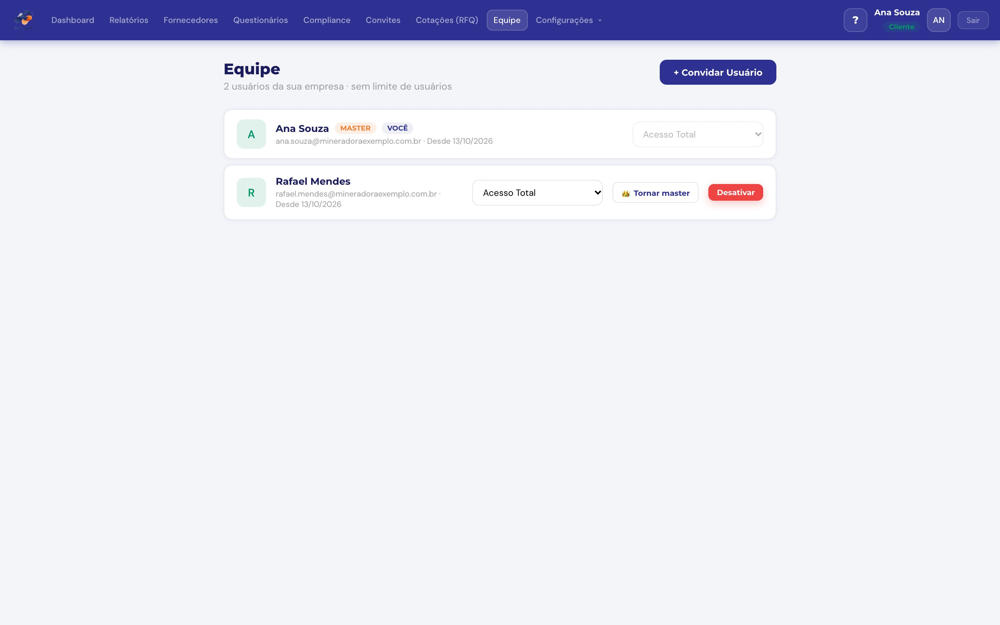

> Os perfis de acesso (por exemplo, "somente consulta") são criados pela equipe EQPI. Eles definem os menus, as abas (como Todos os Fornecedores, Interessados e Pré-cadastros) e ações como priorizar, anexar carta de exceção ou abrir documentos. Peça pelo suporte se precisar de um perfil novo.

---

## 17. Portal de Fornecedores

Menu **Configurações → Portal de Fornecedores**: a página pública com a marca da sua empresa onde fornecedores se cadastram (`elos.eqpitech.com.br/portal/seu-portal`). Configure nome, logo, imagem de capa, cores, contatos, descrição e selos, e marque **Portal ativo**.

O bloco **Login personalizado** traz o link de login com a sua marca, para divulgar à sua equipe e aos fornecedores (**Copiar link**).

Quem chega pelo portal **sem convite** pode escolher entre o **pré-cadastro** (sem custo — aparece em [Pré-cadastros](#11-pré-cadastros)) e a homologação completa. Se a sua empresa estiver inativa na plataforma, o portal mostra apenas **Acessar Plataforma**, para quem já tem conta.

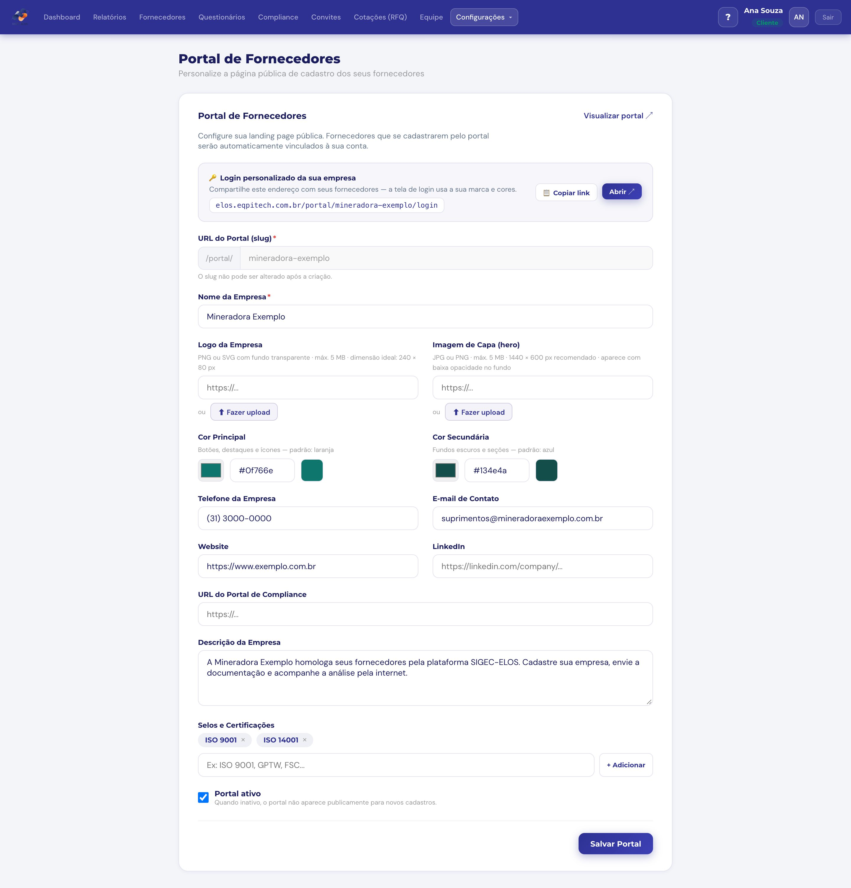

---

## 18. Termos e Aceites

Menu **Configurações → Termos e Aceites**: os documentos que o fornecedor precisa aceitar no cadastro (código de conduta, políticas). Adicione um texto ou um PDF. Cada aceite fica registrado com versão, data e quem aceitou. Alterar um texto cria uma **nova versão**; itens que já têm aceites não podem ser apagados, só desativados.

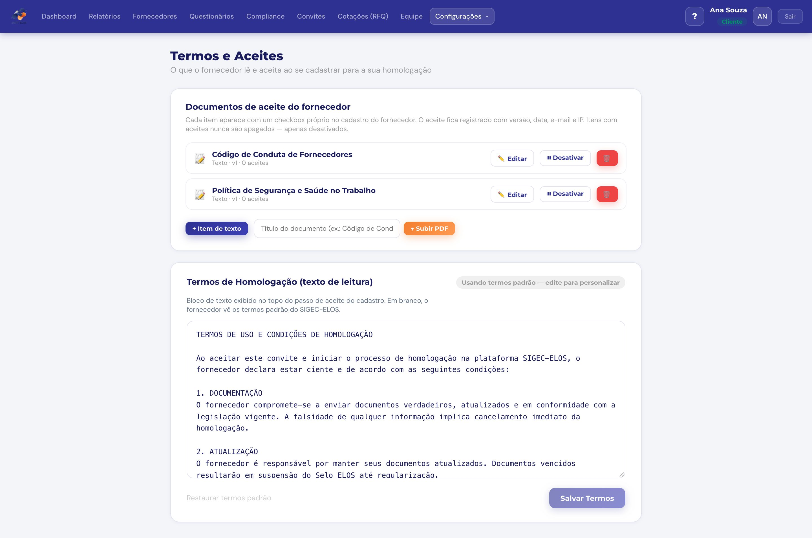

---

## 19. Dúvidas frequentes

**Um fornecedor convidado não aparece na lista.**
Ele aparece em **Convites** até se cadastrar. Depois do cadastro, entra em Meus Fornecedores. Se ele paga a homologação, fica como **Aguardando pagamento** até o pagamento.

**O fornecedor não recebeu o convite.**
Peça para verificar a caixa de spam. Use **Reenviar** em Convites. Confira se o e-mail está correto.

**Posso aceitar um fornecedor com um documento pendente?**
Sim, com a **Carta de Exceção**, por prazo determinado (exceto para categoria reprovada por CNAE).

**Inativar um fornecedor tira a homologação dele com outros clientes?**
Não. A inativação vale só para a sua empresa.

**Quanto tempo leva a análise?**
O prazo padrão é de 3 dias úteis depois que o fornecedor envia tudo (documentos, questionário e Mobilização). Para urgências, use **Priorizar**.

**Quando um processo subsidiado é cobrado da minha empresa?**
Quando entra na fila de análise — documentos completos e questionário respondido —, independentemente de o fornecedor ser aprovado ou reprovado.

**Por que não vejo o nome e o CPF dos colaboradores na Mobilização?**
Por proteção de dados pessoais (LGPD), eles aparecem sempre mascarados para o cliente.

**Preciso da lista em planilha.**
Use **⬇ Exportar Excel** em Meus Fornecedores ou em Convites: a planilha sai com os filtros aplicados.

---

**Precisa de ajuda?** Clique em **?** no alto da tela para abrir a página **Ajuda**, com os manuais e os canais de suporte da EQPI: e-mail **suporte@eqpitech.com.br**, WhatsApp **(11) 5039-6769** e telefone **(11) 2305-3881**.
