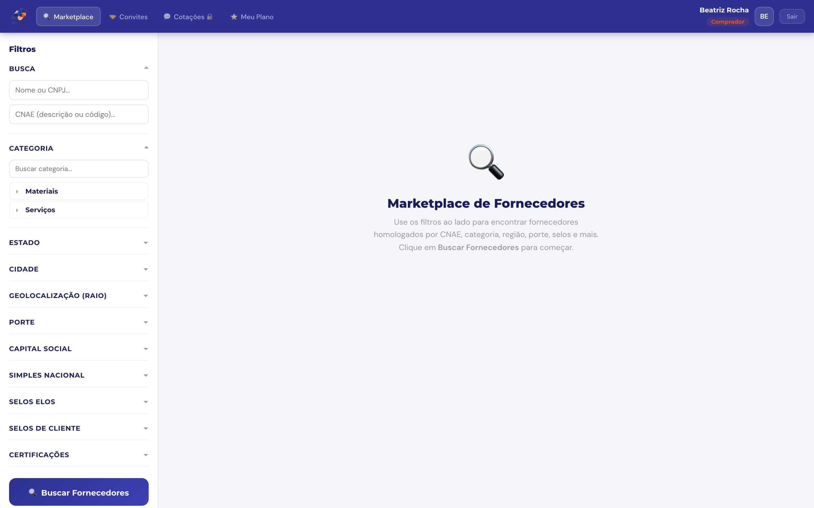
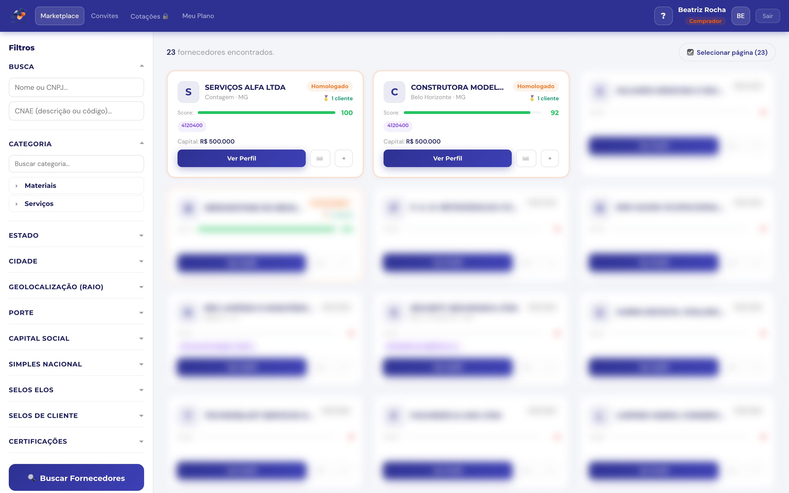
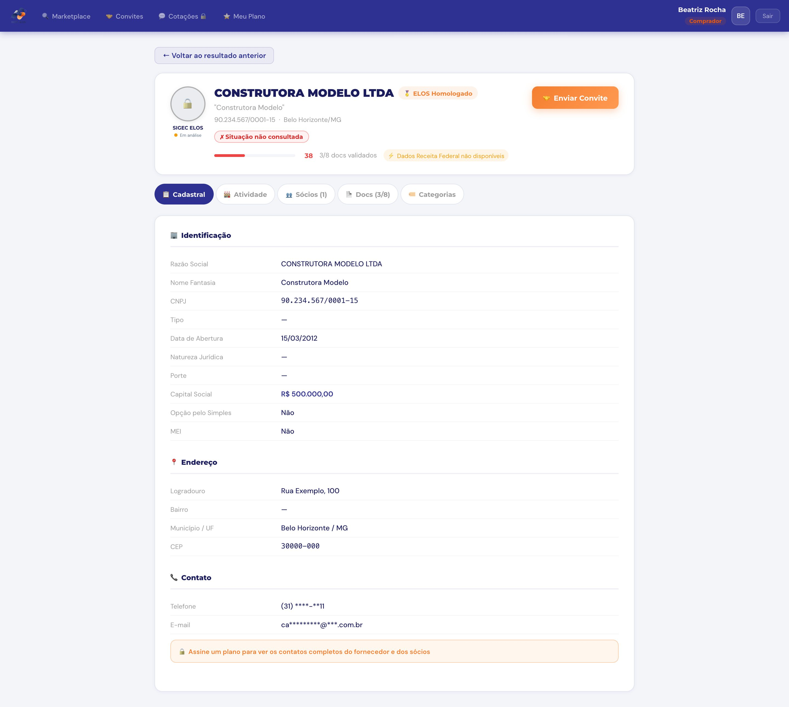
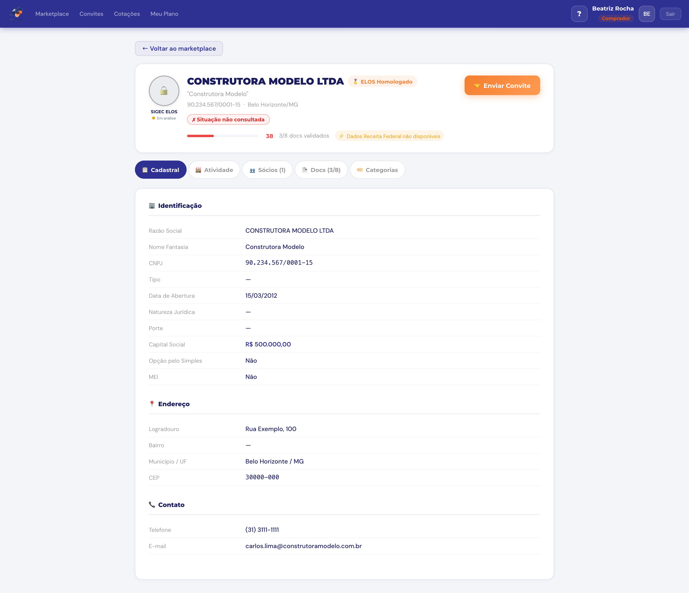
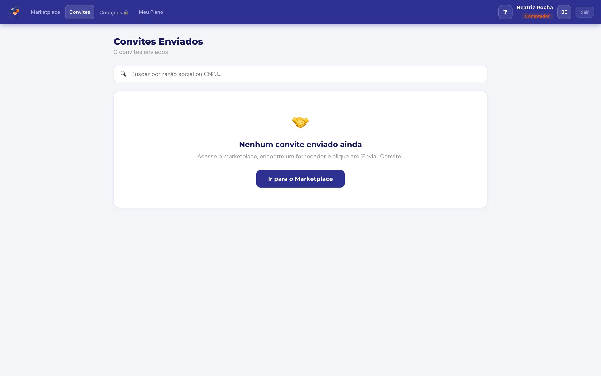
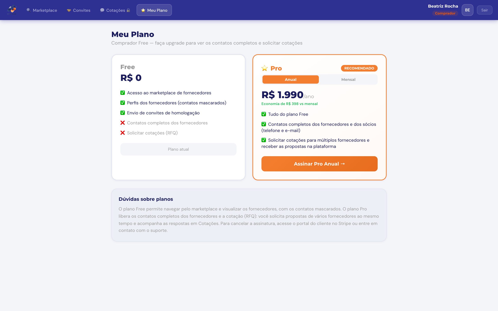
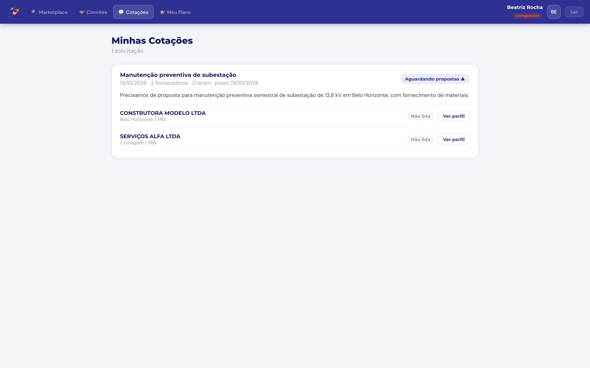

# Manual do Comprador — SIGEC-ELOS

**Para quem é este manual:** compradores que usam o marketplace do SIGEC-ELOS para encontrar fornecedores com documentação verificada, convidá-los e pedir cotações.

> As telas deste manual mostram empresas e pessoas **fictícias** (Comercial Exemplo, Construtora Modelo, etc.).

---

## Sumário

1. [Criar sua conta (grátis)](#1-criar-sua-conta-grátis)
2. [Marketplace](#2-marketplace)
3. [Ficha do fornecedor](#3-ficha-do-fornecedor)
4. [Convidar um fornecedor](#4-convidar-um-fornecedor)
5. [Convites](#5-convites)
6. [Planos: Free e Pro](#6-planos-free-e-pro)
7. [Cotações (Pro)](#7-cotações-pro)
8. [Dúvidas frequentes](#8-dúvidas-frequentes)

---

## 1. Criar sua conta (grátis)

1. Em `elos.eqpitech.com.br`, clique em **Cadastre-se** e escolha **Comprador** (ou, na tela de login, **Comprador? Crie sua conta gratuita**).
2. Informe o CNPJ da sua empresa — a plataforma confere na Receita Federal.
3. Informe seu nome, e-mail corporativo e telefone (opcional).
4. Clique em **Criar conta gratuita**. A senha provisória chega por e-mail; troque-a no primeiro acesso em **Minha Conta**.

Por segurança, a plataforma pede que você ative a **verificação em duas etapas** (código no celular). Você tem 30 dias para ativar.

---

## 2. Marketplace

A tela inicial do comprador. À esquerda ficam os **filtros**:

- **Busca** por nome, CNPJ ou atividade (CNAE);
- **Categoria**, **Estado**, **Cidade** e **raio** a partir de um CEP;
- **Porte**, **Capital social** e **Simples Nacional**;
- **Selos ELOS** (Verificado ou Homologado) e **Selos de Cliente** (quantos clientes já homologaram o fornecedor);
- **Certificações** (ISO 9001, ISO 14001, ISO 45001, PBQP-H…).

Clique em **Buscar Fornecedores**.

Cada resultado mostra o selo (**Homologado**, **Verificado** ou **Sem selo**), quantos clientes homologaram o fornecedor, o score de documentação, a cidade e as atividades. **Ver Perfil** abre a ficha completa.

---

## 3. Ficha do fornecedor

A ficha tem as abas **Cadastral**, **Atividade**, **Sócios**, **Docs** (documentos validados) e **Categorias** — e **Sanções** quando o fornecedor consta nas listas públicas CEIS/CNEP.

**Contatos:**

- No plano **Free**, telefone, e-mail e contatos dos sócios aparecem **ocultos**.
- No plano **Pro**, aparecem **completos**.
- O CPF dos sócios é sempre ocultado, em qualquer plano (proteção de dados pessoais — LGPD).

---

## 4. Convidar um fornecedor

Na ficha, clique em **Enviar Convite** e escolha o objetivo:

- **Fazer contato com o fornecedor** — avisa o fornecedor do seu interesse.
- **Solicitar homologação** — convida o fornecedor a se cadastrar e obter o selo ELOS.

Revise a mensagem e envie. Também é possível convidar vários fornecedores de uma vez no marketplace: marque os resultados e clique em **Convidar**.

> Precisa homologar fornecedores em volume, com preços diferenciados? Fale com o comercial em **comercial@eqpitech.com.br**.

---

## 5. Convites

Menu **Convites**: os convites enviados e a situação de cada um — **Enviado**, **Visualizado** ou **Cadastrado**. **Ver Ficha** abre o fornecedor.

---

## 6. Planos: Free e Pro

Menu **Meu Plano**.

| | Free | Pro |
|---|---|---|
| Marketplace e filtros | ✓ | ✓ |
| Fichas e documentos validados | ✓ | ✓ |
| Convites a fornecedores | ✓ | ✓ |
| Contatos completos dos fornecedores | — | ✓ |
| Cotações para fornecedores e acompanhamento das propostas | — | ✓ |

O Pro pode ser **mensal** ou **anual** (o anual sai mais barato). O pagamento é pelo Stripe (cartão). Para cancelar, use o portal de assinatura ou fale com o suporte.

---

## 7. Cotações (Pro)

1. No marketplace, marque os fornecedores e clique em **Cotação**.
2. Escreva o assunto, a mensagem e, se quiser, o prazo para resposta. Envie (até 200 fornecedores por cotação).
3. Os fornecedores recebem o pedido na caixa **Cotações** deles e respondem com uma proposta.
4. Acompanhe no menu **Cotações**: quantos receberam, leram e responderam, e as propostas de cada um.

---

## 8. Dúvidas frequentes

**Por que os contatos aparecem ocultos?**
No plano Free os contatos ficam ocultos. Assine o **Pro** para vê-los completos.

**O que significa o selo do fornecedor?**
**Verificado:** documentação básica conferida (dados da Receita e certidões principais). **Homologado:** documentação completa analisada pela equipe EQPI. **Selos de Cliente:** o fornecedor foi homologado por empresas contratantes da plataforma.

**O fornecedor que convidei não respondeu.**
Confira em **Convites** se ele visualizou. Você pode reenviar o convite pela ficha.

**Sou fornecedor. Posso usar o marketplace?**
Sim — todo fornecedor tem o perfil Comprador. Troque o perfil no seletor ao lado do seu nome, no alto da tela.

---

**Precisa de ajuda?** Escreva para **suporte@eqpitech.com.br**.
