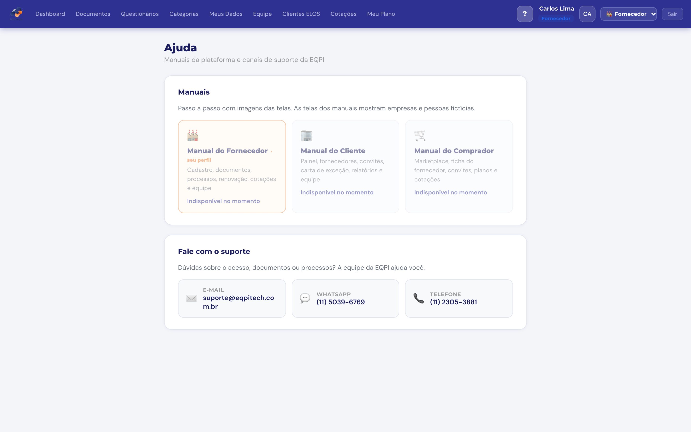

# Manual do Fornecedor — SIGEC-ELOS

**Para quem é este manual:** empresas que querem ser homologadas como fornecedoras de um cliente na plataforma SIGEC-ELOS, ou obter o selo ELOS para aparecer no marketplace.

**O que é a homologação:** antes de contratar um fornecedor, a empresa contratante (o "cliente") precisa conferir se ele está em dia com os documentos legais, fiscais e técnicos. No SIGEC-ELOS você envia esses documentos pela internet, a equipe da EQPI analisa, e você acompanha tudo na tela até receber o certificado.

> As telas deste manual mostram empresas e pessoas **fictícias** (Mineradora Exemplo, Construtora Modelo, etc.).

---

## Sumário

1. [Como você chega ao SIGEC-ELOS](#1-como-você-chega-ao-sigec-elos)
2. [Criar o cadastro, passo a passo](#2-criar-o-cadastro-passo-a-passo)
3. [Pagamento](#3-pagamento)
4. [Entrar na plataforma](#4-entrar-na-plataforma)
5. [Painel](#5-painel)
6. [Documentos](#6-documentos)
7. [Questionários](#7-questionários)
8. [A análise e o resultado](#8-a-análise-e-o-resultado)
9. [Certificado](#9-certificado)
10. [Categorias](#10-categorias)
11. [Meus Dados](#11-meus-dados)
12. [Equipe](#12-equipe)
13. [Clientes ELOS](#13-clientes-elos)
14. [Cotações](#14-cotações)
15. [Perfil Comprador](#15-perfil-comprador)
16. [Meu Plano](#16-meu-plano)
17. [E-mails que você vai receber](#17-e-mails-que-você-vai-receber)
18. [Dúvidas frequentes](#18-dúvidas-frequentes)

---

## 1. Como você chega ao SIGEC-ELOS

Existem três caminhos:

| Caminho | Como funciona |
|---|---|
| **Convite por e-mail** | O cliente envia um convite. Clique no link do e-mail: o CNPJ já vem preenchido e sua empresa já fica ligada ao processo daquele cliente. |
| **Portal do cliente** | Muitos clientes têm uma página própria no SIGEC-ELOS (por exemplo `elos.eqpitech.com.br/portal/nome-do-cliente`). Clique em **Iniciar Cadastro**, informe o CNPJ e clique em **Solicitar Cadastro**. |
| **Cadastro direto** | Em `elos.eqpitech.com.br`, clique em **Cadastre-se** para obter o selo ELOS e aparecer no marketplace, mesmo sem convite de um cliente. |

> **Portal que não recebe novos cadastros:** quando o cliente não está mais ativo na plataforma, o portal dele mostra apenas **Acessar Plataforma**, para quem já tem conta entrar com e-mail e senha. Não é possível iniciar um cadastro novo por esse portal.

---

## 2. Criar o cadastro, passo a passo

As etapas do cadastro mudam conforme a forma como você chegou:

| Situação | Etapas |
|---|---|
| Cadastro direto, ou convite/portal em que **você** paga a homologação | Empresa, Categorias, Conta, Termos, Plano, Pagamento |
| Convite **subsidiado** (o cliente paga) | Empresa, Categorias, Conta, Termos |
| Empresa **já homologada** (processo ativo encontrado na base) | Empresa, Conta, Termos |

### Etapa 1 — Empresa

Digite o CNPJ e clique em **Consultar CNPJ**. A plataforma busca os dados na Receita Federal e preenche razão social, endereço e atividades.

> **CNPJ com letras:** desde julho de 2026 a Receita Federal emite CNPJs com letras (por exemplo `12.ABC.345/01DE-35`). Eles são aceitos normalmente — digite como está no seu cartão CNPJ.

O que pode aparecer nesta etapa:

- **"Esta empresa já está cadastrada no SIGEC-ELOS"** — sua empresa já tem acesso e processo em andamento: não é preciso cadastrar de novo. Use **Entrar** com o login da empresa (o e-mail do responsável aparece parcialmente para você reconhecer) ou **Esqueci minha senha**. Se outra pessoa da empresa precisa de acesso, peça ao responsável para incluí-la em **Equipe**, ou fale com o suporte.
- **"Sua empresa já está homologada!"** — encontramos um processo ativo: clique em **Criar Acesso** e entre direto, **sem pagamento**.
- **"Esta empresa já tem acesso ao ELOS"** — na etapa **Conta**, entre com o login que já existe; não é preciso criar outro.
- **"Esta empresa veio do HOC"** — empresa que veio do sistema anterior da EQPI: o primeiro acesso ao ELOS só é liberado para os **e-mails cadastrados no HOC** (eles aparecem parcialmente na tela). Use um deles na etapa Conta. Precisa usar outro e-mail? Fale com o suporte. Já usava o HOC e ainda não criou a senha no ELOS? Use **Esqueci minha senha** com o seu e-mail do HOC.
- **"Sua empresa já tem homologação vigente no ELOS"** — você já é homologado para outro cliente. A homologação com este novo cliente é um **processo novo**; os documentos válidos que você já enviou são aproveitados.
- **Situação cadastral irregular ou sanções** — a plataforma avisa. Regularize junto à Receita ou prossiga sabendo que a análise vai considerar a restrição.

### Etapa 2 — Categorias

Marque as categorias de produtos e serviços que sua empresa oferece. **As categorias definem quais documentos serão pedidos.** Use a busca, ou o botão **Sugerir por CNAE**. Se você veio por convite, o cliente pode já ter definido as categorias possíveis.

### Etapa 3 — Conta

Informe seu nome, um e-mail corporativo e uma senha (mínimo de 8 caracteres). Se a empresa já tem cadastro, esta etapa vira **Entre com a conta da empresa**.

### Etapa 4 — Termos

Leia e aceite os termos de uso. Quando você chega por um cliente (convite ou portal), aparecem também os **documentos do próprio cliente** (código de conduta, políticas) para aceitar um a um — o aceite fica registrado.

A última caixa, **publicação no marketplace**, é **opcional**: com ela sua empresa aparece nas buscas de compradores; sem ela, não aparece.

### Etapa 5 — Plano

- **Chegou por convite de um cliente:** aparece a homologação com aquele cliente (**Homologado — nome do cliente**), pelo valor combinado entre a EQPI e o cliente.
- **Chegou pelo portal de um cliente, sem convite:** aparecem duas opções:
  - **Pré-cadastro (sem custo):** o cliente passa a ver o cadastro da sua empresa e pode convidá-la para a homologação. Você responde o questionário do cliente e usa o perfil Comprador, mas **ainda não envia documentos**. Clique em **Concluir pré-cadastro**.
  - **Homologado — nome do cliente:** a homologação completa, pelo valor combinado entre a EQPI e o cliente.
- **Cadastro direto:** escolha entre **ELOS Verificado** e **ELOS Homologado**.

### Etapa 6 — Pagamento

Confira o resumo e clique em **Pagar com segurança via Stripe**. Os meios aceitos aparecem logo abaixo do botão. Veja a próxima seção.

---

## 3. Pagamento

| Meio | Onde vale | Quando o acesso é liberado |
|---|---|---|
| **Cartão de crédito** | Homologação com um cliente e planos ELOS | Na hora |
| **Pix** | Só no pagamento único da **homologação com um cliente** | Na hora |
| **Boleto** | Homologação com um cliente e planos ELOS | Depois que o banco confirmar o pagamento (normalmente em até 3 dias úteis) |

- Os **planos ELOS** (Verificado e Homologado) são assinaturas: pague com **cartão ou boleto**. O Pix não está disponível para assinaturas.
- **Convite subsidiado:** o cliente paga a homologação — você não passa pelo pagamento e o acesso é liberado no cadastro.

**Enquanto o pagamento não é confirmado**, a plataforma libera apenas **Pagamento**, **Meu Plano**, **Minha Conta** e **Ajuda**. No painel, o processo aparece com **💳 Aguardando pagamento · Pagar**. O envio de documentos é liberado assim que o pagamento é confirmado.

**Pagou com boleto?** A tela **Pagamento** mostra **"Boleto emitido — aguardando compensação"**. O acesso é liberado sozinho quando o banco confirmar; se já pagou, clique em **↻ Já paguei — verificar agora**.

**Boleto emitido antes da mudança para o SIGEC-ELOS:** se sua empresa veio do sistema anterior (HOC) com um boleto ainda a vencer, o processo aparece no painel como **⏳ Boleto em compensação**. **Não é preciso pagar de novo:** assim que o pagamento do boleto for confirmado, o processo é liberado automaticamente.

**Pré-cadastro:** quem fez só o pré-cadastro (sem custo) acessa o Painel, **Questionários**, **Meus Dados**, **Equipe** e **Clientes ELOS**, mas não envia documentos até iniciar a homologação.

---

## 4. Entrar na plataforma

Acesse `elos.eqpitech.com.br`, clique em **Entrar**, informe e-mail e senha.

- **Esqueci minha senha:** clique no link, informe o e-mail e siga o link recebido.
- **Verificação em duas etapas:** por segurança, a plataforma pede que você ative um código no celular (aplicativos como Google Authenticator ou Microsoft Authenticator). Você tem **30 dias** para ativar (botão **Deixar para depois**); depois disso a ativação passa a ser obrigatória. Depois de digitar um código válido, **este navegador fica lembrado por 24 horas**: um novo login nesse prazo não pede o código de novo.
- **Trocou de celular?** Use **Minha Conta → Trocar de aparelho**. Perdeu o acesso ao aplicativo? Fale com o suporte: a EQPI reseta a verificação (e os navegadores lembrados deixam de ser reconhecidos).

### A barra do topo

- **?** — abre a página **Ajuda**, com os manuais em PDF e os canais de suporte da EQPI.
- **Seu nome** — abre **Minha Conta** (senha, verificação em duas etapas).
- **Seletor de empresa** — aparece quando o seu login tem acesso a **mais de uma empresa** fornecedora: escolha a empresa com que quer trabalhar.
- **Seletor de perfil** — troca entre **Fornecedor** e **Comprador** (veja [Perfil Comprador](#15-perfil-comprador)).

---

## 5. Painel

É a tela inicial. Mostra:

- **Score geral** — quanto dos documentos exigidos está válido.
- **Indicadores** — processos ativos, documentos válidos, em análise e seu plano.
- **Carteira de Selos** — um selo por cliente que homologou você (e o selo ELOS, se tiver). Clique no selo para abrir o processo. Selo ativo mostra **Certificado disponível**; processo sem pagamento mostra **💳 Aguardando pagamento · Pagar** (ou **⏳ Boleto em compensação**).
- **Meus Processos de Homologação** — um cartão por processo, com a situação e os contadores de documentos aprovados (✓), em análise (⏳) e pendentes (✗).
- **Documentos Recentes.**

---

## 6. Documentos

Menu **Documentos**. Os documentos aparecem agrupados por processo (um bloco por cliente e um bloco para o fluxo padrão ELOS), cada um com o resumo de aprovados, em análise e não enviados. Um documento pedido por mais de um processo é enviado **uma única vez**.

### Situação de cada documento

| Situação | O que significa | O que fazer |
|---|---|---|
| **Não enviado** | Ainda falta enviar. | Clique em **↑ Enviar**. |
| **Em análise** | Você enviou; a equipe EQPI está analisando. | Aguarde. |
| **Aprovado** | Documento aprovado e dentro da validade. | Nada. |
| **Vence em breve** | Faltam 30 dias ou menos para o vencimento. | Clique em **↑ Renovar** e envie a versão nova. |
| **Vencido** | Passou da validade. | Envie a versão atualizada (**↑ Enviar**). |
| **Reprovado** | O documento tinha um problema. O motivo aparece logo abaixo. | Corrija e clique em **↑ Enviar**. |
| **Não se aplica** | A EQPI avaliou que o documento não é exigível para a sua empresa. | Nada. |

Outras marcas que podem aparecer na linha do documento:

| Marca | Significado |
|---|---|
| **Com a EQPI** | Documento que a própria EQPI obtém (por exemplo, a Inscrição Estadual). Você não precisa enviar. |
| **Na análise** | O processo já está na fila de análise: o documento só pode ser reenviado se for reprovado. |
| **♻ Validado — aproveitado neste processo** | Documento já aprovado antes, reaproveitado neste processo. |
| **◌ Não exigido** | A EQPI dispensou o documento para a sua empresa. |
| **sem permissão** | Seu perfil de acesso não permite enviar documentos. Fale com o usuário master da sua empresa. |

### Trocar um documento já enviado

- **Antes de o processo entrar na fila de análise**, você pode trocar qualquer documento já enviado com **↻ Substituir**. O arquivo novo vira uma **nova versão** e o anterior fica guardado no histórico.
- **Depois que o processo entra na fila**, só é possível reenviar o documento **reprovado** e renovar o que **vence em breve** (ou venceu).

### Histórico e versões (🕓)

O botão **🕓** mostra o histórico do documento: cada envio (**Versão 1, 2, 3…**), aprovações, reprovações e validades. **Ver arquivo** abre o arquivo daquela versão.

### Documentos que buscamos para você

Vários documentos públicos (Cartão CNPJ, Simples Nacional, FGTS, certidões trabalhista e federais, entre outros) são **buscados automaticamente** pela plataforma nas fontes oficiais:

- **🔎 Consultando fonte oficial** — estamos buscando; não precisa enviar. Se a fonte estiver instável, a plataforma tenta de novo ao longo do dia antes de pedir o arquivo a você.
- **🏛 Fonte oficial** — obtivemos o documento; a equipe EQPI confere.
- **"A fonte oficial não emitiu este documento para a sua empresa"** — a fonte respondeu, mas não emitiu a certidão por uma pendência da sua empresa. Regularize a pendência junto ao órgão e envie o arquivo.
- **"Não conseguimos obter este documento na fonte oficial"** — envie o arquivo você mesmo.
- **🌐 Emitir** — abre o site oficial para você baixar a certidão.

**Certidão positiva:** quando a fonte emite uma certidão **positiva** (com débitos), ela entra como documento **Em análise**, com a certidão oficial. A equipe EQPI vai reprová-la: regularize a situação e envie a certidão negativa (ou positiva com efeito de negativa).

**Renovação automática:** quando um documento que a plataforma sabe buscar está perto de vencer (até 7 dias) ou **já venceu (até 90 dias)**, ela **consulta de novo sozinha** — inclusive se você tinha enviado o arquivo à mão — e o documento novo volta para análise.

### Inscrição Estadual e Municipal

- A **Inscrição Estadual** é obtida pela EQPI no Sintegra. Você **não envia** esse documento e ele não tem o botão **Isento**; quando a consulta não dá certo, ele aparece como **Com a EQPI** e a equipe cuida dele.
- A **Inscrição Municipal** isenta: use o botão **Isento** no próprio documento.

### Documentos de Mobilização

Quando o cliente tem mão de obra sua alocada em postos de trabalho, o bloco do processo dele traz a seção **👷 Documentos de Mobilização** (marcada como **parte deste processo**). Ela tem um cartão por posto:

1. Abra o posto (📍 categoria — cidade/UF). O cartão mostra quantas pessoas já foram cadastradas e quantos documentos estão em ordem, ou **✓ Posto conforme**.
2. Em **Documentos do posto**, envie os documentos pedidos para aquele local.
3. Em **Colaboradores**, clique em **+ Cadastrar colaborador**, informe **nome completo** e **CPF** e clique em **Salvar**. Cadastre quantas pessoas o posto pede.
4. Depois do cadastro aparecem os documentos **da pessoa para aquele posto** (certidões e certificados podem variar conforme a cidade). Envie cada um com **↑ Enviar**.

O CPF aparece sempre mascarado na tela. Os documentos de Mobilização contam para a entrada do processo na fila, como os demais.

### Outros detalhes

- **Formatos aceitos:** PDF, JPG, PNG ou DOCX, até 20 MB.
- **Apresentação da Empresa:** opcional (PDF, PPTX ou PPT, até 50 MB). É aprovada automaticamente.

---

## 7. Questionários

Alguns clientes pedem um questionário (por exemplo, de compliance). Menu **Questionários**: responda as perguntas e clique em **Salvar Respostas**. Você pode responder aos poucos. Perguntas com asterisco vermelho são obrigatórias.

### Quando o processo entra na fila de análise

Cada processo entra na fila da EQPI **sozinho**, quando você completa tudo o que é seu **naquele processo**:

- todos os **documentos** exigidos enviados — documento **reprovado** ou **vencido** não conta como enviado;
- o **questionário** do cliente respondido;
- a **Mobilização** completa, quando houver (pessoas cadastradas e documentos de cada pessoa e de cada posto);
- e o pagamento confirmado (ou o convite subsidiado).

Documentos que são obtidos pela EQPI (como a Inscrição Estadual) ou que são de responsabilidade do cliente **não seguram** a entrada na fila.

---

## 8. A análise e o resultado

1. Quando você termina de enviar tudo, aparece **"Documentos enviados — sua homologação está em análise"**. O prazo padrão de análise é de **3 dias úteis**.
2. Quando a equipe começa a analisar, você recebe o e-mail **"Sua homologação entrou em análise"**.
3. Se algum documento for reprovado, você recebe um e-mail com o motivo. Corrija e reenvie.
4. Quando todos os documentos forem analisados, o resultado sai automaticamente:
   - **Aprovado** — o selo fica **Ativo** e você recebe o e-mail com o certificado.
   - **Reprovado** — o processo aparece como **Reprovado**, com os documentos que têm pendência. Corrija e reenvie: o processo volta para análise.

### Situação do processo

| Situação | Significado |
|---|---|
| **Aguardando seus dados** | Faltam documentos, Mobilização ou respostas do questionário. |
| **Em análise** | A equipe EQPI está analisando. |
| **Ativo** | Você está homologado. |
| **Reprovado** | A análise encontrou pendências. Veja o motivo e reenvie. |
| **Suspenso** | Um documento importante venceu, ou o cliente suspendeu o processo. |
| **Expirado** | A validade da homologação terminou. |

Clique em **Ver Processo** em qualquer cartão para ver o progresso, os dados do processo e o histórico.

---

## 9. Certificado

Com o selo **Ativo**, clique em **Certificado disponível** (painel) ou em **Abrir Certificado de Homologação** (processo). Use **Imprimir / Salvar PDF**.

O certificado tem um **código** (ELOS-…) e um link de verificação. Qualquer pessoa pode conferir se ele é verdadeiro e está vigente em `elos.eqpitech.com.br/verificar`.

---

## 10. Categorias

Menu **Categorias**: adicione ou remova categorias e clique em **Salvar alterações**. Mudar categorias pode mudar a lista de documentos pedidos.

> **Categoria e atividade (CNAE):** na análise, a EQPI confere se as atividades (CNAE) do seu CNPJ cobrem cada categoria. Uma categoria que a sua atividade não cobre pode ser **reprovada dentro do processo** — o processo segue normalmente com as demais, mas a categoria reprovada não aparece no certificado, no seu perfil, nas buscas por categoria nem nas cotações.

---

## 11. Meus Dados

Menu **Meus Dados**: mantenha atualizados contato, e-mail financeiro, endereço, inscrições e o quadro de sócios. O CNPJ não pode ser alterado. A razão social é atualizada pela Receita Federal.

> **Privacidade:** o CPF dos sócios nunca aparece completo para quem consulta sua ficha.

---

## 12. Equipe

Menu **Equipe**: até **4 usuários ativos** por empresa. Cada empresa tem **um único usuário master** (marcado com 👑). **Só o master** convida colegas com e-mail corporativo, escolhe o **perfil de acesso** de cada um e pode desativá-los ou reativá-los. Os demais membros veem a equipe, mas não a gerenciam.

- **👑 Tornar master** — o master passa a função para outro membro ativo. Ele deixa de ser o master: quem convida e gerencia a equipe passa a ser essa pessoa. O suporte da EQPI também pode trocar o master.
- **Limite de 4 usuários:** com 4 ativos, a tela avisa **"Limite de 4 usuários atingido. Desative um membro para liberar uma vaga."**

---

## 13. Clientes ELOS

Menu **Clientes ELOS**: lista as empresas que homologam fornecedores na plataforma. Com o selo ativo, clique em **Quero prestar serviços** para declarar interesse — o cliente vê sua empresa numa lista de interessados e pode convidá-la para a homologação.

---

## 14. Cotações

Menu **Cotações**: pedidos de cotação enviados por clientes que homologaram sua empresa e por compradores do marketplace (marcados com 🛒 · comprador). Os dois tipos de pedido também chegam **por e-mail**.

Abra o pedido, escreva sua proposta (e o valor, se quiser) e clique em **📤 Enviar proposta**. Enquanto quem pediu não decidir e o prazo não terminar, você pode mudar a proposta com **💾 Atualizar proposta**.

| Situação | Significado |
|---|---|
| **Nova** | Pedido ainda não aberto. |
| **Aguardando você** | Você abriu, mas ainda não respondeu. |
| **Proposta enviada** | Sua proposta foi enviada; aguarde a decisão. |
| **Aceita pelo cliente** / **Aceita pelo comprador** | Quem pediu escolheu a sua proposta. |
| **Não selecionada** | Quem pediu escolheu outra proposta. |

---

## 15. Perfil Comprador

Todo fornecedor ganha também o perfil **Comprador**, para pesquisar outros fornecedores no marketplace. Troque o perfil no seletor ao lado do seu nome, no alto da tela. Enquanto seu selo estiver ativo, você vê os contatos completos dos fornecedores.

---

## 16. Meu Plano

Para quem se cadastrou direto (sem cliente): menu **Meu Plano** mostra os planos **ELOS Verificado** e **ELOS Homologado** com os valores atuais. O pagamento é pelo Stripe, com **cartão ou boleto**. Quem está num processo de cliente não precisa escolher plano.

---

## 17. E-mails que você vai receber

| E-mail | Quando |
|---|---|
| Convite para homologação | Um cliente convidou sua empresa. Lembretes a cada 3 dias, por até 15 dias. |
| Bem-vindo ao SIGEC-ELOS | Logo após o cadastro. |
| Documentos obtidos automaticamente | Após a busca nas fontes oficiais: o que já obtivemos e o que falta. |
| Faltam pendências | A cada 3 dias, enquanto faltarem documentos, Mobilização ou respostas (até 5 vezes). |
| Documentos pendentes na sua homologação | Quando a equipe EQPI pede, de uma vez, o que falta no processo. |
| Falta confirmar o pagamento | Se o pagamento estiver pendente. |
| Sua homologação entrou em análise | Quando a equipe começa a analisar. |
| Documento reprovado | Com o motivo, para você reenviar. |
| Homologação concluída | Aprovação, com o link do certificado. |
| Atualização sobre sua homologação | Reprovação, com as pendências. |
| Documentos vencendo | 30, 15, 7, 3 e 1 dia antes do vencimento, e no dia. |
| Nova solicitação de cotação | Um cliente ou um comprador do marketplace pediu cotação. |

Confira também a caixa de spam. Os e-mails saem de `noreply@eqpitech.com.br`.

---

## 18. Dúvidas frequentes

**Rejeitaram meu documento. E agora?**
O motivo aparece no próprio documento. Corrija (certidão vencida, arquivo ilegível, documento de outra empresa…) e envie de novo — ele volta para a análise.

**Enviei o arquivo errado. Posso trocar?**
Se o processo ainda não entrou na fila de análise, sim: use **↻ Substituir** (o arquivo anterior fica no histórico). Com o processo já na fila, o documento aparece como **Na análise** e só pode ser reenviado se for reprovado.

**Meu documento vai vencer. Preciso esperar vencer para enviar o novo?**
Não. Quando ele aparece como **Vence em breve**, use **↑ Renovar**. Se for um documento que a plataforma busca nas fontes oficiais, ela tenta renovar sozinha.

**Por que a Inscrição Estadual não pede arquivo?**
Ela é obtida pela EQPI. Você não precisa enviar nem declarar isenção.

**Posso ser fornecedor de mais de um cliente?**
Sim. Cada cliente tem o próprio processo e o próprio selo. Documentos comuns são aproveitados.

**Por que não consigo enviar documentos?**
O pagamento ainda não foi confirmado, você fez apenas o pré-cadastro, o processo já está na fila de análise (veja **Na análise**) ou o seu perfil de acesso não permite (**sem permissão**).

**Enviei tudo, mas o processo não entrou em análise.**
Confira se falta a **Mobilização** (pessoas ou documentos de algum posto), o questionário, ou se há documento reprovado ou vencido. O resumo do processo em **Documentos** mostra o que falta.

**Uso o mesmo login em mais de uma empresa.**
Troque de empresa no seletor ao lado do seu nome, no alto da tela.

**Quem vê os dados da minha empresa?**
Os clientes que homologam você e a equipe EQPI veem a ficha completa. Compradores do marketplace só veem contatos completos se tiverem o plano Pro. O CPF dos sócios e dos colaboradores é sempre ocultado.

**Outra pessoa da empresa precisa acessar.**
O usuário master convida pelo menu **Equipe** (até 4 usuários).

---

**Precisa de ajuda?** Clique em **?** no alto da tela para abrir a página **Ajuda**, com os manuais e os canais de suporte da EQPI: e-mail **suporte@eqpitech.com.br**, WhatsApp **(11) 5039-6769** e telefone **(11) 2305-3881**.
