# Manual do Fornecedor — SIGEC-ELOS

**Para quem é este manual:** empresas que querem ser homologadas como fornecedoras de um cliente na plataforma SIGEC-ELOS, ou obter o selo ELOS para aparecer no marketplace.

**O que é a homologação:** antes de contratar um fornecedor, a empresa contratante (o "cliente") precisa conferir se ele está em dia com os documentos legais, fiscais e técnicos. No SIGEC-ELOS você envia esses documentos pela internet, a equipe da EQPI analisa, e você acompanha tudo na tela até receber o certificado.

> As telas deste manual mostram empresas e pessoas **fictícias** (Mineradora Exemplo, Construtora Modelo, etc.).

---

## Sumário

1. [Como você chega ao SIGEC-ELOS](#1-como-você-chega-ao-sigec-elos)
2. [Criar o cadastro, passo a passo](#2-criar-o-cadastro-passo-a-passo)
3. [Pagamento](#3-pagamento)
4. [Entrar na plataforma](#4-entrar-na-plataforma)
5. [Painel](#5-painel)
6. [Documentos](#6-documentos)
7. [Questionário](#7-questionário)
8. [A análise e o resultado](#8-a-análise-e-o-resultado)
9. [Certificado](#9-certificado)
10. [Categorias](#10-categorias)
11. [Meus Dados](#11-meus-dados)
12. [Equipe](#12-equipe)
13. [Clientes ELOS](#13-clientes-elos)
14. [Cotações](#14-cotações)
15. [Perfil Comprador](#15-perfil-comprador)
16. [Meu Plano](#16-meu-plano)
17. [E-mails que você vai receber](#17-e-mails-que-você-vai-receber)
18. [Dúvidas frequentes](#18-dúvidas-frequentes)

---

## 1. Como você chega ao SIGEC-ELOS

Existem três caminhos:

| Caminho | Como funciona |
|---|---|
| **Convite por e-mail** | O cliente envia um convite. Clique no link do e-mail: o CNPJ já vem preenchido e sua empresa já fica ligada ao processo daquele cliente. |
| **Portal do cliente** | Muitos clientes têm uma página própria no SIGEC-ELOS (por exemplo `elos.eqpitech.com.br/portal/nome-do-cliente`). Informe o CNPJ e clique em **Solicitar Cadastro**. |
| **Cadastro direto** | Em `elos.eqpitech.com.br`, clique em **Cadastre-se** para obter o selo ELOS e aparecer no marketplace, mesmo sem convite de um cliente. |

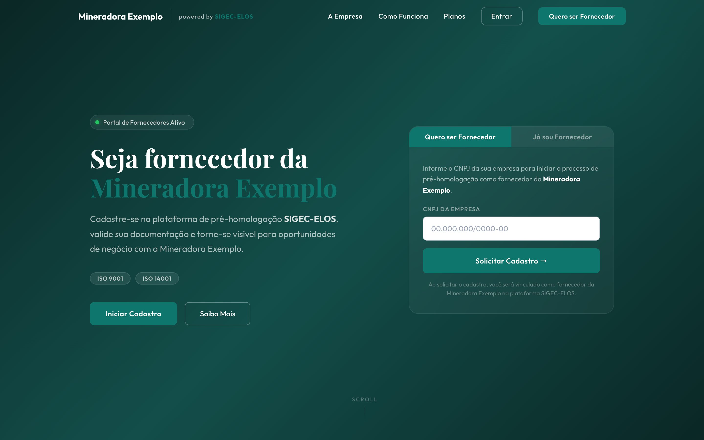

---

## 2. Criar o cadastro, passo a passo

O cadastro tem até seis etapas. Algumas não aparecem, dependendo de como você chegou (por exemplo, quem recebe um convite **subsidiado** não passa pelo pagamento).

### Etapa 1 — Empresa

Digite o CNPJ e clique em **Consultar CNPJ**. A plataforma busca os dados na Receita Federal e preenche razão social, endereço e atividades.

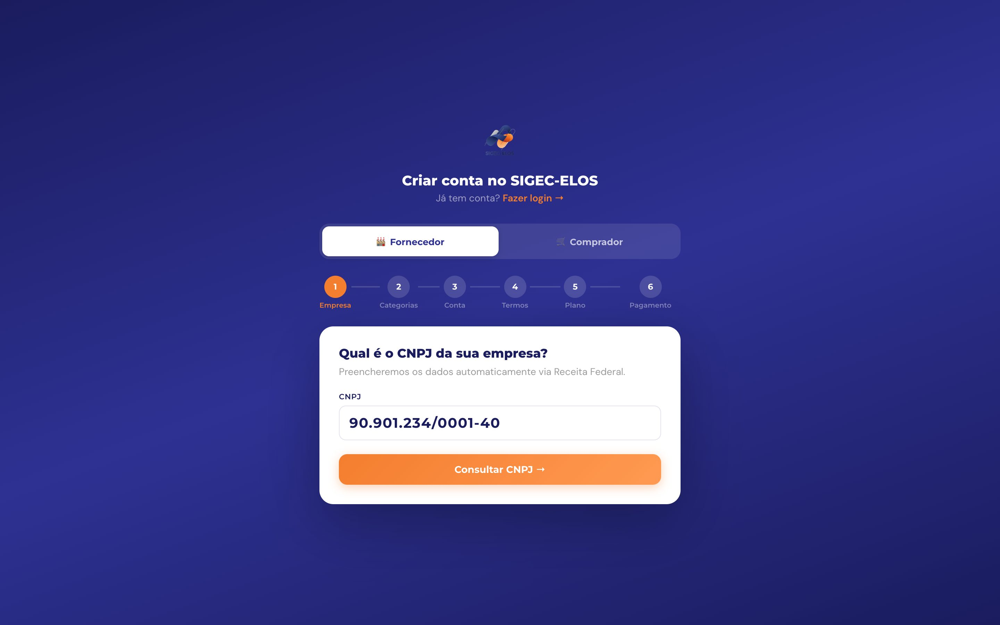

> **CNPJ com letras:** desde julho de 2026 a Receita Federal emite CNPJs com letras (por exemplo `12.ABC.345/01DE-35`). Eles são aceitos normalmente — digite como está no seu cartão CNPJ.

O que pode aparecer nesta etapa:

- **"Esta empresa já tem acesso ao ELOS"** — sua empresa já tem cadastro. Na etapa Conta, entre com o login que já existe (o e-mail do responsável aparece parcialmente para você reconhecer). Se você não tem acesso, peça a quem tem para incluir você na **Equipe**.
- **"Sua empresa já tem homologação vigente no ELOS"** — você já é homologado para outro cliente. A homologação com este novo cliente é um **processo novo**; os documentos válidos que você já enviou são aproveitados.
- **Situação cadastral irregular ou sanções** — a plataforma avisa. Regularize junto à Receita ou prossiga sabendo que a análise vai considerar a restrição.

### Etapa 2 — Categorias

Marque as categorias de produtos e serviços que sua empresa oferece. **As categorias definem quais documentos serão pedidos.** Use a busca, ou o botão **Sugerir por CNAE**. Se você veio por convite, o cliente pode já ter definido as categorias possíveis.

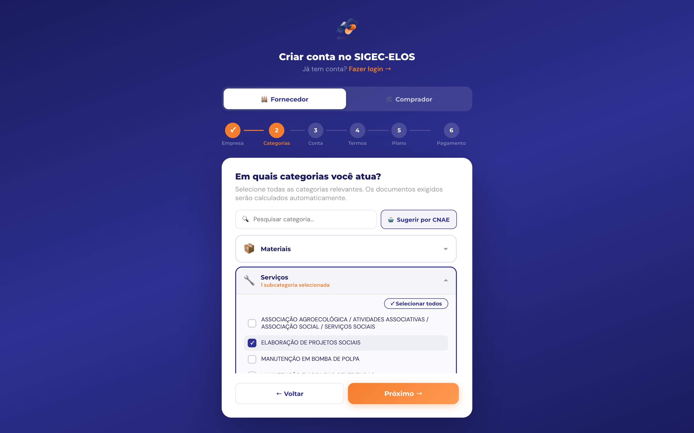

### Etapa 3 — Conta

Informe seu nome, um e-mail corporativo e uma senha (mínimo de 8 caracteres). Se a empresa já tem cadastro, esta etapa vira **Entre com a conta da empresa**.

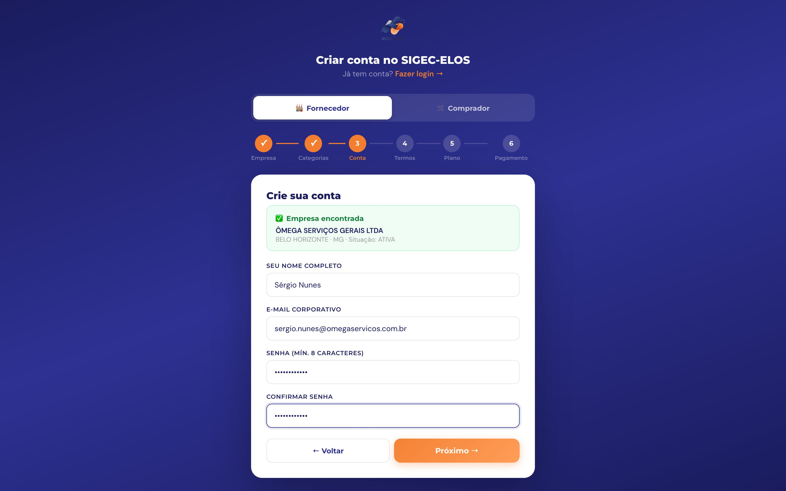

### Etapa 4 — Termos

Leia e aceite os termos de uso. Quando você chega por um cliente, aparecem também os **documentos do próprio cliente** (código de conduta, políticas) para aceitar um a um — o aceite fica registrado.

A última caixa, **publicação no marketplace**, é **opcional**: com ela sua empresa aparece nas buscas de compradores; sem ela, não aparece.

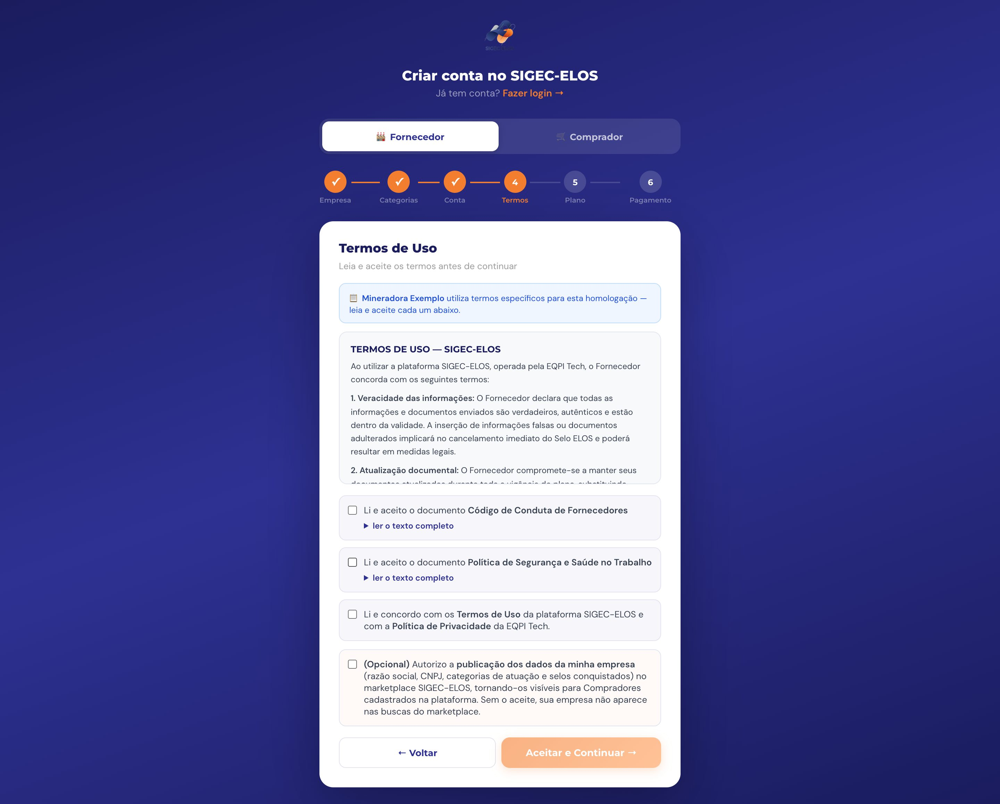

### Etapa 5 — Plano

- **Chegou pelo portal ou convite de um cliente:** aparecem duas opções:
  - **Pré-cadastro (sem custo):** o cliente passa a ver o cadastro da sua empresa e pode convidá-la para a homologação. Você responde o questionário do cliente e usa o perfil Comprador, mas **ainda não envia documentos**.
  - **Homologado — nome do cliente:** a homologação completa, pelo valor combinado entre a EQPI e o cliente.
- **Cadastro direto:** escolha entre **ELOS Verificado** e **ELOS Homologado**.

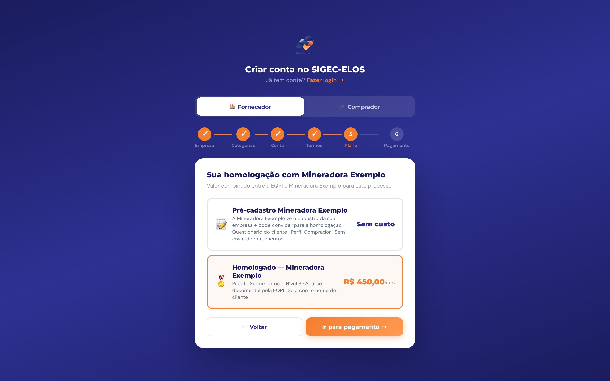

### Etapa 6 — Pagamento

Confira o resumo e clique em **Pagar com segurança via Stripe**. Veja a próxima seção.

---

## 3. Pagamento

- **Cartão de crédito ou PIX:** a liberação é imediata.
- **Boleto:** a liberação acontece quando o banco confirmar o pagamento (normalmente 1 a 3 dias úteis). Você recebe um e-mail.
- **Convite subsidiado:** o cliente paga a homologação — você não passa pelo pagamento e entra direto.

> **Importante:** enquanto o pagamento não é confirmado, a plataforma mostra apenas a tela de **Pagamento**. O envio de documentos é liberado assim que o pagamento é confirmado. Se o pagamento estiver pendente, entre e clique em **Pagamento** no aviso do painel.

---

## 4. Entrar na plataforma

Acesse `elos.eqpitech.com.br`, clique em **Entrar**, informe e-mail e senha.

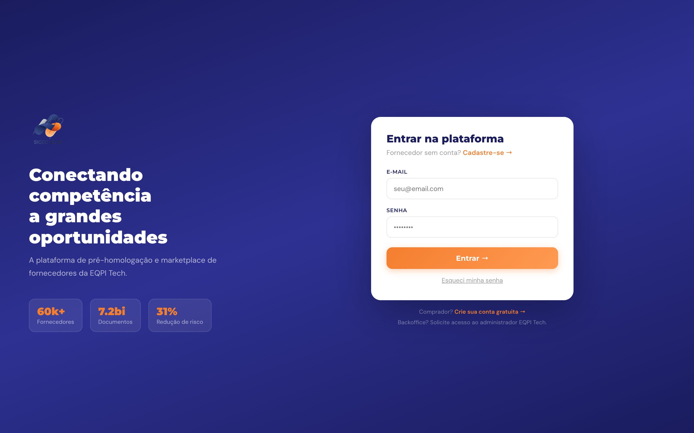

- **Esqueci minha senha:** clique no link, informe o e-mail e siga o link recebido.
- **Verificação em duas etapas:** por segurança, a plataforma pede que você ative um código no celular (aplicativos como Google Authenticator ou Microsoft Authenticator). Você tem **30 dias** para ativar; depois disso a ativação passa a ser obrigatória. Se trocar de celular, use **Minha Conta → Trocar de aparelho**; se perder o acesso, fale com o suporte.

---

## 5. Painel

É a tela inicial. Mostra:

- **Score geral** — quanto dos documentos exigidos está válido.
- **Indicadores** — processos ativos, documentos válidos, em análise e seu plano.
- **Carteira de Selos** — um selo por cliente que homologou você (e o selo ELOS, se tiver). Clique no selo para abrir o processo. Selo ativo mostra **Certificado disponível**.
- **Meus Processos de Homologação** — um cartão por processo, com a situação e os contadores de documentos aprovados (✓), em análise (⏳) e pendentes (✗).
- **Documentos Recentes.**

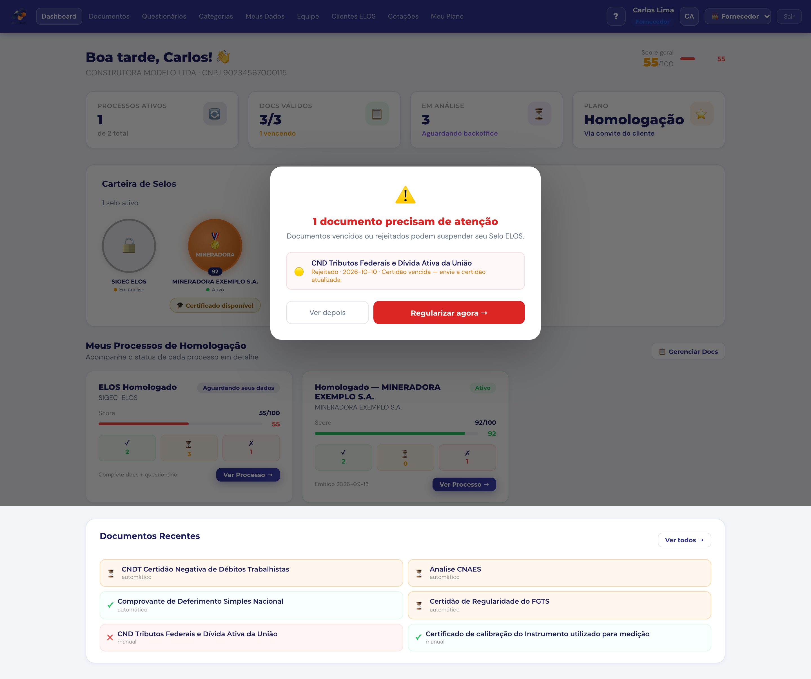

---

## 6. Documentos

Menu **Documentos**. Os documentos aparecem agrupados por processo (um bloco por cliente e um bloco para o fluxo padrão ELOS). Um documento pedido por mais de um processo é enviado **uma única vez**.

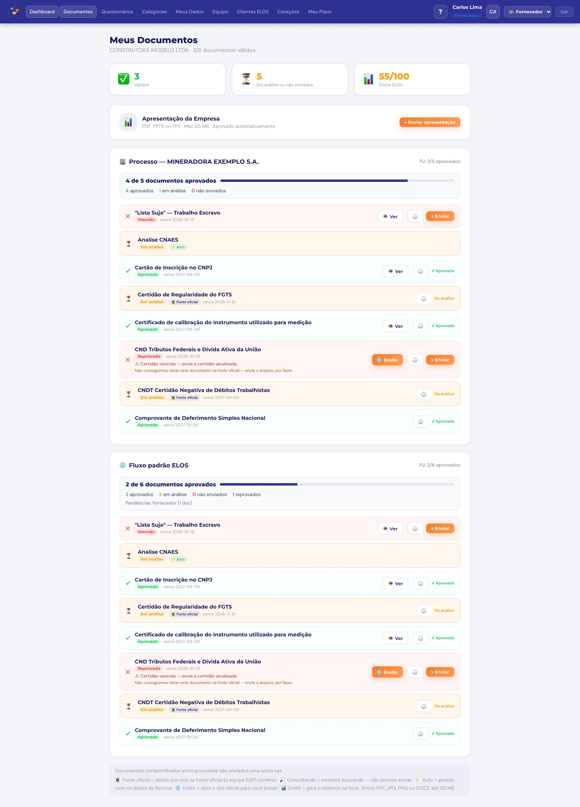

### Situação de cada documento

| Situação | O que significa | O que fazer |
|---|---|---|
| **Não enviado** | Ainda falta enviar. | Clique em **↑ Enviar**. |
| **Em análise** | Você enviou; a equipe EQPI está analisando. | Aguarde. |
| **Válido / Aprovado** | Documento aprovado e dentro da validade. | Nada. |
| **Vence em breve** | Faltam poucos dias para o vencimento. | Clique em **↑ Renovar** e envie a versão nova. |
| **Vencido** | Passou da validade. | Envie a versão atualizada. |
| **Rejeitado** | O documento tinha um problema. O motivo aparece logo abaixo. | Corrija e clique em **↑ Enviar**. |
| **Não se aplica / Não exigido** | Não é necessário para o seu caso. | Nada. |

### Documentos que buscamos para você

Vários documentos públicos (Cartão CNPJ, Simples Nacional, FGTS, certidões trabalhista e federais, entre outros) são **buscados automaticamente** pela plataforma nas fontes oficiais:

- **🔎 Consultando fonte oficial** — estamos buscando; não precisa enviar.
- **🏛 Fonte oficial** — obtivemos o documento; a equipe EQPI confere.
- **"Não conseguimos obter este documento na fonte oficial"** — envie o arquivo você mesmo.
- **🌐 Emitir** — abre o site oficial para você baixar a certidão.

Quando um documento obtido na fonte oficial está perto de vencer, a plataforma **consulta de novo sozinha** e o documento volta para análise.

### Outros detalhes

- **Formatos aceitos:** PDF, JPG, PNG, DOCX ou ZIP, até 20 MB.
- **Apresentação da Empresa:** opcional (PDF ou PowerPoint, até 50 MB). É aprovada automaticamente.
- **Inscrição Estadual ou Municipal isenta:** use o botão **Isento** no próprio documento.

---

## 7. Questionário

Alguns clientes pedem um questionário (por exemplo, de compliance). Menu **Questionário**: responda as perguntas e clique em **Salvar Respostas**. Você pode responder aos poucos. Perguntas com asterisco vermelho são obrigatórias.

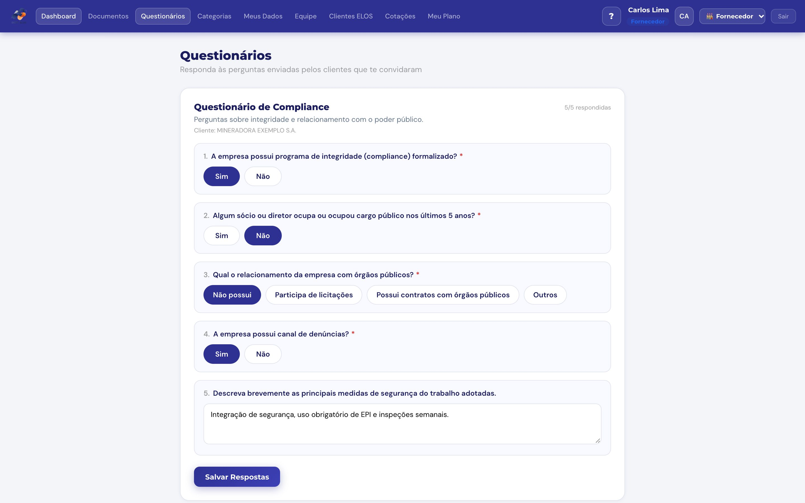

> O processo só entra na fila de análise depois que **todos os documentos foram enviados e o questionário foi respondido**.

---

## 8. A análise e o resultado

1. Quando você termina de enviar tudo, aparece **"Documentos enviados — sua homologação está em análise"**. O prazo padrão de análise é de **3 dias úteis**.
2. Quando a equipe começa a analisar, você recebe o e-mail **"Sua homologação entrou em análise"**.
3. Se algum documento for rejeitado, você recebe um e-mail com o motivo. Corrija e reenvie.
4. Quando todos os documentos forem analisados, o resultado sai automaticamente:
   - **Aprovado** — o selo fica **Ativo** e você recebe o e-mail com o certificado.
   - **Reprovado** — o processo aparece como **Reprovado**, com os documentos que têm pendência. Corrija e reenvie: o processo volta para análise.

### Situação do processo

| Situação | Significado |
|---|---|
| **Aguardando seus dados** | Faltam documentos ou respostas do questionário. |
| **Em análise** | A equipe EQPI está analisando. |
| **Ativo** | Você está homologado. |
| **Reprovado** | A análise encontrou pendências. Veja o motivo e reenvie. |
| **Suspenso** | Um documento importante venceu, ou o cliente suspendeu o processo. |
| **Expirado** | A validade da homologação terminou. |

Clique em **Ver Processo** em qualquer cartão para ver o progresso, os dados do processo e o histórico.

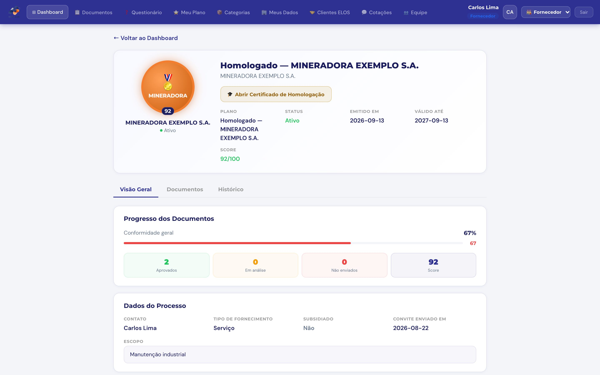

---

## 9. Certificado

Com o selo **Ativo**, clique em **Certificado disponível** (painel) ou em **Abrir Certificado de Homologação** (processo). Use **Imprimir / Salvar PDF**.

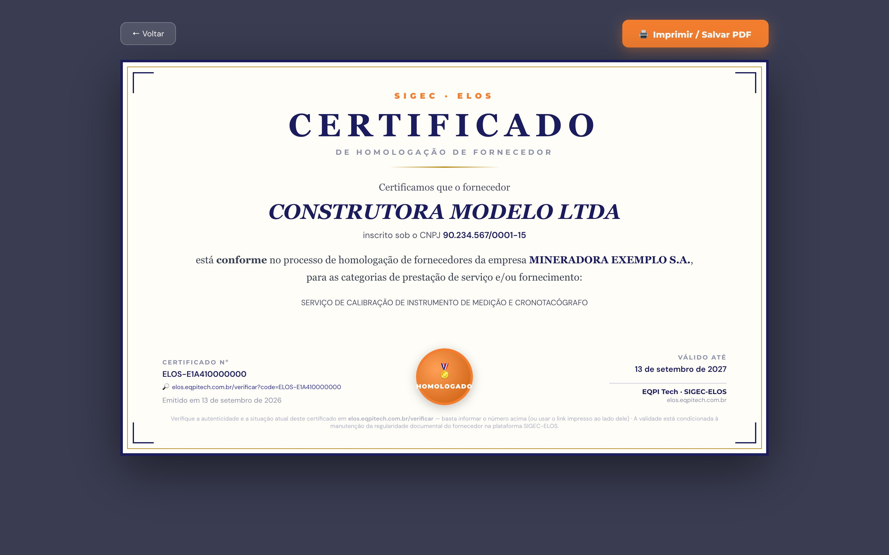

O certificado tem um **código** (ELOS-…) e um link de verificação. Qualquer pessoa pode conferir se ele é verdadeiro e está vigente em `elos.eqpitech.com.br/verificar`.

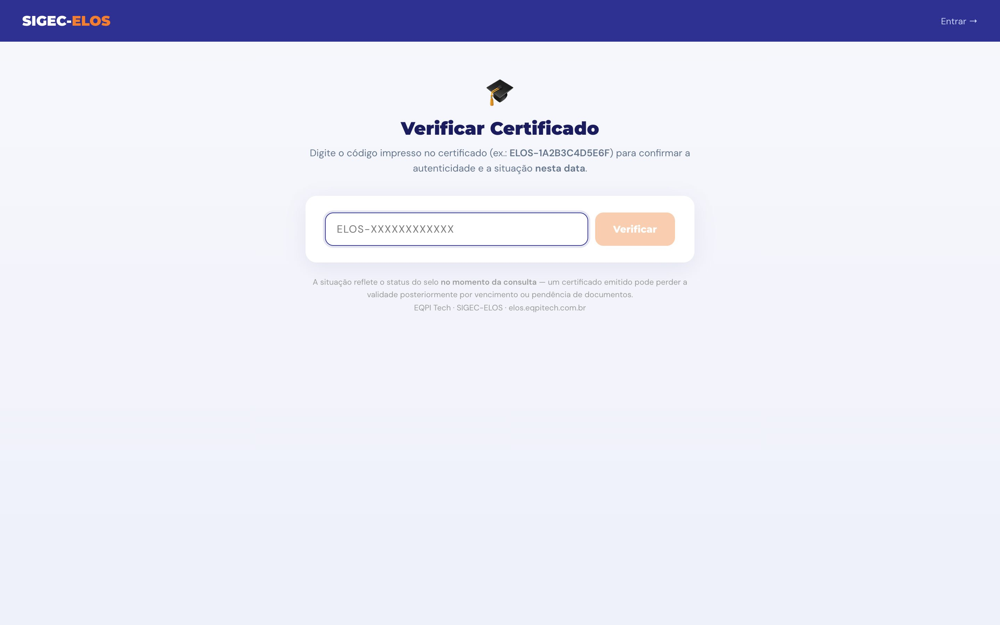

---

## 10. Categorias

Menu **Categorias**: adicione ou remova categorias e clique em **Salvar alterações**. Mudar categorias pode mudar a lista de documentos pedidos.

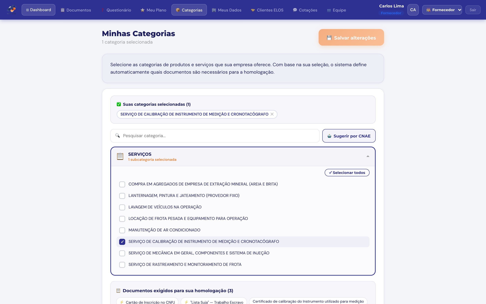

---

## 11. Meus Dados

Menu **Meus Dados**: mantenha atualizados contato, e-mail financeiro, endereço, inscrições e o quadro de sócios. O CNPJ não pode ser alterado. A razão social é atualizada pela Receita Federal.

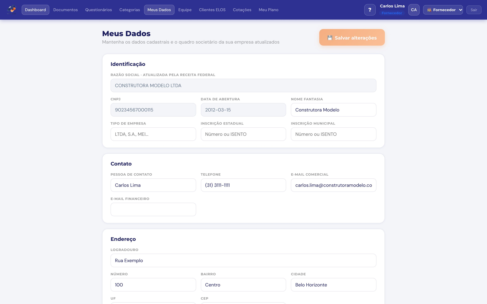

> **Privacidade:** o CPF dos sócios nunca aparece completo para quem consulta sua ficha.

---

## 12. Equipe

Menu **Equipe**: até **4 usuários ativos** por empresa. O usuário **master** (quem criou o cadastro) convida colegas com e-mail corporativo, escolhe o **perfil de acesso** de cada um e pode desativá-los.

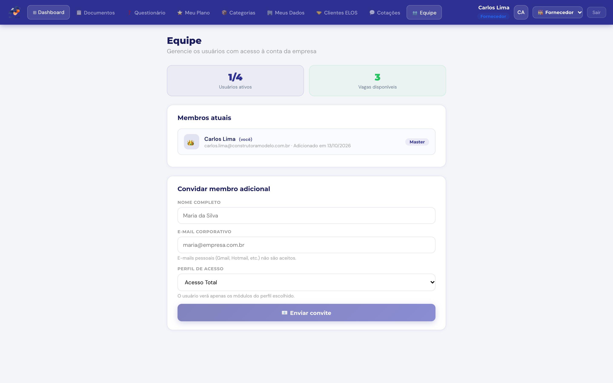

---

## 13. Clientes ELOS

Menu **Clientes ELOS**: lista as empresas que homologam fornecedores na plataforma. Com o selo ativo, clique em **Quero prestar serviços** para declarar interesse — o cliente vê sua empresa numa lista de interessados e pode convidá-la para a homologação.

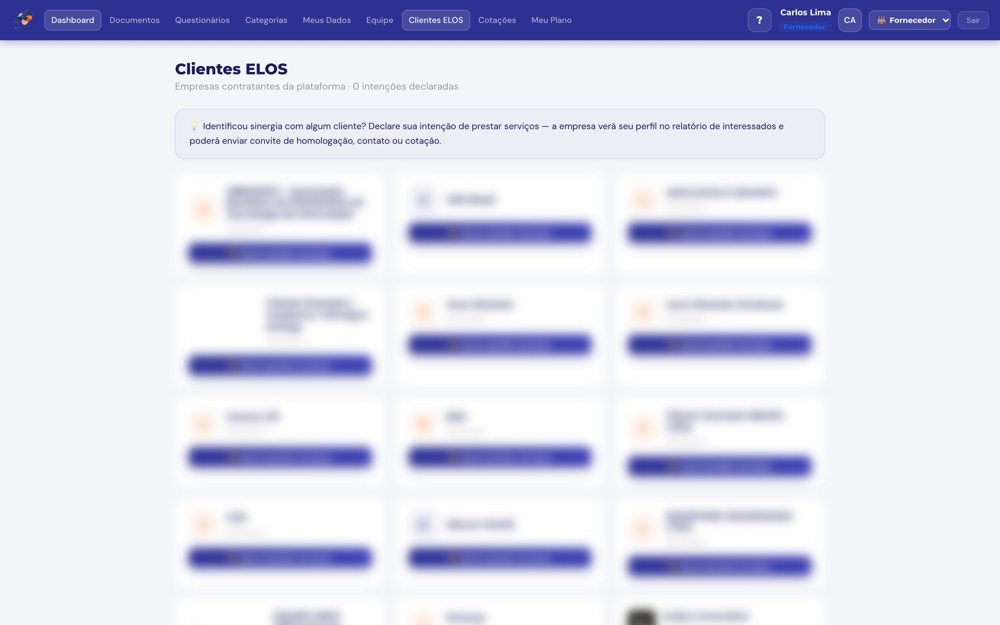

---

## 14. Cotações

Menu **Cotações**: pedidos de cotação enviados por clientes que homologaram sua empresa e por compradores do marketplace. Abra o pedido, escreva sua proposta (e o valor, se quiser) e clique em **Enviar proposta**.

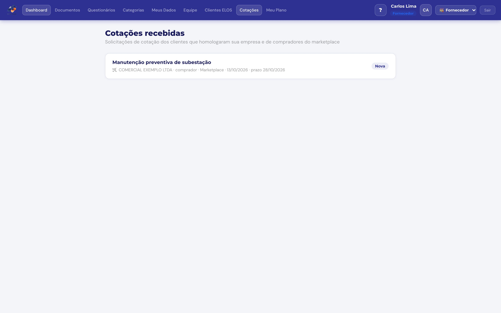

---

## 15. Perfil Comprador

Todo fornecedor ganha também o perfil **Comprador**, para pesquisar outros fornecedores no marketplace. Troque o perfil no seletor ao lado do seu nome, no alto da tela. Enquanto seu selo estiver ativo, você vê os contatos completos dos fornecedores.

---

## 16. Meu Plano

Para quem se cadastrou direto (sem cliente): menu **Meu Plano** mostra os planos **ELOS Verificado** e **ELOS Homologado** com os valores atuais. Quem está num processo de cliente não precisa escolher plano.

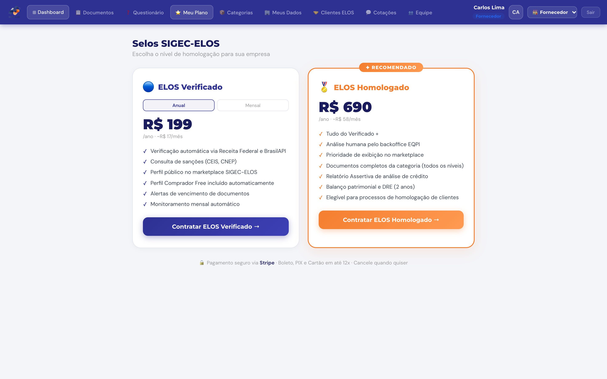

---

## 17. E-mails que você vai receber

| E-mail | Quando |
|---|---|
| Convite para homologação | Um cliente convidou sua empresa. Lembretes a cada 3 dias, por até 15 dias. |
| Bem-vindo ao SIGEC-ELOS | Logo após o cadastro. |
| Documentos obtidos automaticamente | Após a busca nas fontes oficiais: o que já obtivemos e o que falta. |
| Faltam pendências | A cada 3 dias, enquanto faltarem documentos ou respostas (até 5 vezes). |
| Falta confirmar o pagamento | Se o pagamento estiver pendente. |
| Sua homologação entrou em análise | Quando a equipe começa a analisar. |
| Documento reprovado | Com o motivo, para você reenviar. |
| Homologação concluída | Aprovação, com o link do certificado. |
| Atualização sobre sua homologação | Reprovação, com as pendências. |
| Documentos vencendo | 30, 15, 7, 3 e 1 dia antes do vencimento, e no dia. |
| Nova solicitação de cotação | Um cliente pediu cotação. |

Confira também a caixa de spam. Os e-mails saem de `noreply@eqpitech.com.br`.

---

## 18. Dúvidas frequentes

**Rejeitaram meu documento. E agora?**
O motivo aparece no próprio documento. Corrija (certidão vencida, arquivo ilegível, documento de outra empresa…) e envie de novo — ele volta para a análise.

**Meu documento vai vencer. Preciso esperar vencer para enviar o novo?**
Não. Quando ele aparece como **Vence em breve**, use **↑ Renovar**.

**Posso ser fornecedor de mais de um cliente?**
Sim. Cada cliente tem o próprio processo e o próprio selo. Documentos comuns são aproveitados.

**Por que não consigo enviar documentos?**
O pagamento ainda não foi confirmado, ou você fez apenas o pré-cadastro. Veja o aviso no painel.

**Quem vê os dados da minha empresa?**
Os clientes que homologam você e a equipe EQPI veem a ficha completa. Compradores do marketplace só veem contatos completos se tiverem o plano Pro. O CPF dos sócios é sempre ocultado.

**Outra pessoa da empresa precisa acessar.**
O usuário master convida pelo menu **Equipe** (até 4 usuários).

---

**Precisa de ajuda?** Escreva para **suporte@eqpitech.com.br**.
